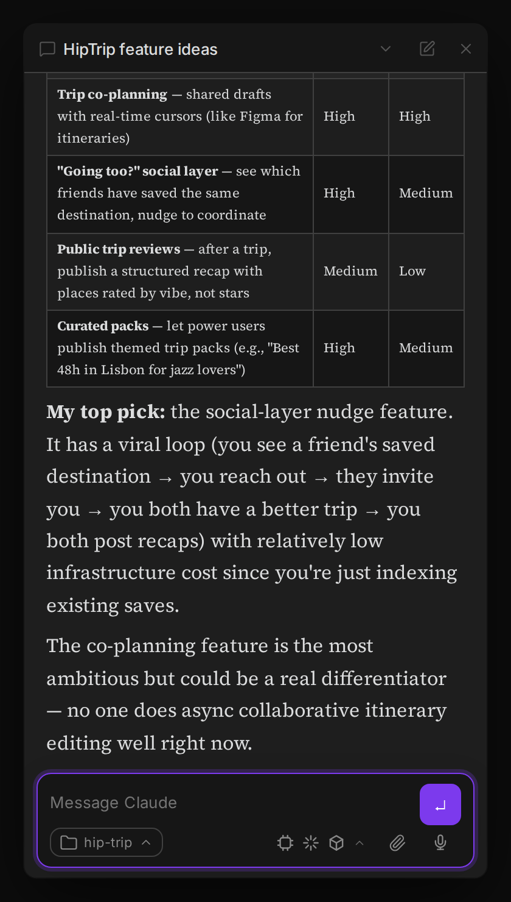
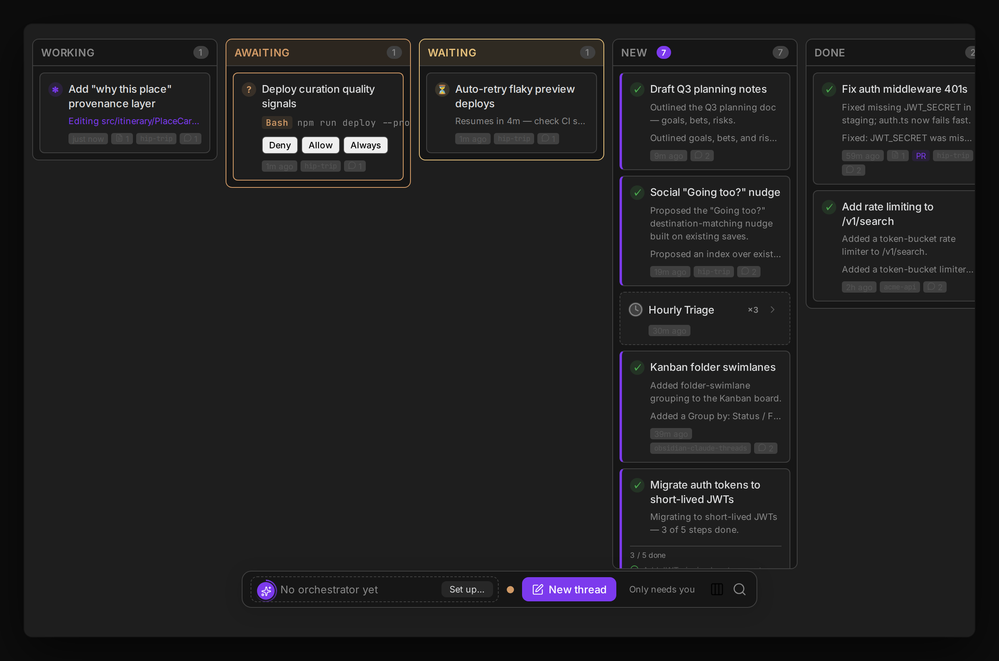
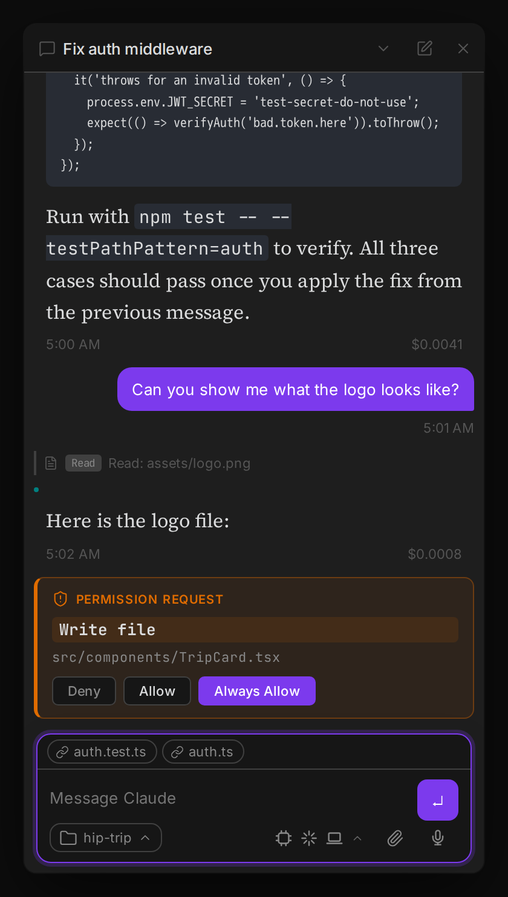

# Agent Threads

**Run many Claude Code, Codex and OpenCode agents in parallel, right inside your notes. A free, open-source plugin for Geode and Obsidian.**
Every thread is its own agent session with streaming replies, visible tool calls and inline permission prompts, and everything stays local in your vault.

[](https://github.com/rbcodelabs/agent-threads/releases)
[](LICENSE)
[](https://github.com/rbcodelabs/agent-threads/stargazers)
[](docs/usage.md)

[](docs/images/agent-threads-hero.mp4)

## Why Agent Threads

- **Parallel by default.** Run as many sessions as you like at once. The Agents List shows what each thread is doing and whether it needs you.
- **Bring your own agent.** Claude Code, OpenAI Codex or OpenCode drive a thread, picked per install in Settings.
- **Agent Board.** See every thread as a card, grouped by status or by project, from idle to running to waiting to done.
- **Sub-agents you can follow.** A pill in the composer counts background agents. Open the tree and read any agent's activity timeline.
- **You stay in control.** Claude and Codex ask before they write files or run commands, inline in the conversation. Plan Mode lets you approve a plan first.
- **Local-first, in your vault.** Threads live next to your notes and link to them. No account, no hosted service in the middle.
- **Goals, loops and schedules.** Pin a goal with `/goal`, or re-run a prompt with `/loop 10m <prompt>`.

## Quick start

Agent Threads runs in [Geode](https://geode.rbcodelabs.com) and in Obsidian. You also need at least one agent CLI installed and signed in, see [Prerequisites](#prerequisites).

**In Geode (easiest).** Agent Threads is in Geode's supported-plugin catalog.

```bash
brew install --cask rbcodelabs/geode/geode
```

Open a vault. On the first-run onboarding screen, the **Recommended: Agent Threads** card installs and enables it with one click. Later, go to **Settings → Community plugins**, find Agent Threads in the supported catalog and choose **Install**.

**In Obsidian, via [BRAT](https://github.com/TfTHacker/obsidian42-brat).**

1. Install BRAT from Community Plugins.
2. In BRAT settings choose **Add Beta Plugin** and enter `rbcodelabs/agent-threads`.
3. Enable **Agent Threads** in Settings → Community Plugins.

**Manual install.**

1. Download the latest release from [GitHub Releases](https://github.com/rbcodelabs/agent-threads/releases).
2. Extract it into `<vault>/.obsidian/plugins/claude-threads/` for Obsidian, or `<vault>/.geode/plugins/claude-threads/` for Geode.
3. Enable **Agent Threads** in Settings → Community Plugins.

> **Upgrade compatibility:** the repository, plugin ID, install folder, saved command IDs, workspace view types, and `claude_threads` MCP namespace retain their historical names so existing installations, hotkeys, layouts, and automations continue to work.

Then open the **Agents List**, press **New thread**, type what you want and hit Enter.

## What you get

| | |
|---|---|
| **Conversations** | Streaming Markdown, tool-call pills and groups, persistent sessions, auto-named tabs, thread summaries, compressed view |
| **Many agents at once** | Agents List, Agent Board, sub-agent tree, Projects with shared context, message queue |
| **Control** | Inline permission cards, Plan Mode, cancel and restore, Always Allow rules, MCP elicitation |
| **Vault integration** | `@` file mentions, clickable wikilinks, chat about or watch a note, edited-files focus, Skills Manager |
| **Automation** | `/goal`, `/loop`, scheduled runs, Claude Code skills and slash commands, MCP servers (including OAuth ones) |
| **Reach** | Remote daemons, a local container daemon, mobile remote access, push-to-talk voice input, an agent browser (Geode desktop) |

The complete list is in the [feature reference](docs/features.md).

<p align="center">
  
</p>

<p align="center">
  
</p>

<p align="center">
  
</p>

## Prerequisites

- Geode, or Obsidian v1.0.0+.
- At least one agent harness, installed and signed in:
  - [Claude Code CLI](https://docs.anthropic.com/en/docs/claude-code) (auto-detected in the usual install locations; Amazon Bedrock is supported).
  - [OpenAI Codex CLI](https://developers.openai.com/codex/cli/): select **OpenAI Codex** in Settings → Agent → Agent harness.
  - [OpenCode](https://opencode.ai) (desktop only), with a provider configured: select **OpenCode** in the same setting.

Sign-in, Bedrock and per-harness details are in [Prerequisites and harness setup](docs/prerequisites.md).

## Documentation

| Guide | What is in it |
|---|---|
| [Usage guide](docs/usage.md) | Tabs, slash commands, Agents List, Agent Board, permissions, MCP, remote access, projects |
| [Feature reference](docs/features.md) | Every feature, in detail |
| [Settings reference](docs/settings.md) | Every setting |
| [Agent tools reference](docs/agent-tools.md) | The MCP tools agents can call, and the peer-plugin API |
| [Agent workspace](docs/agent-workspace.md) | Sub-agents, capability matrix and recovery behavior |
| [Building and releasing](docs/development.md) | Build from source, tests, release process |

Vote on upcoming features at the [public roadmap](https://compass.rbcodelabs.com/portal/rbcodelabs/claude-threads/roadmap).

## Contributing

Issues and PRs are welcome. See [CONTRIBUTING.md](CONTRIBUTING.md) and [Building and releasing](docs/development.md) to build from source. Good places to start are open issues labeled [`good first issue`](https://github.com/rbcodelabs/agent-threads/labels/good%20first%20issue).

If Agent Threads is useful to you, a star helps other people find it.

## License

[MIT](LICENSE)
