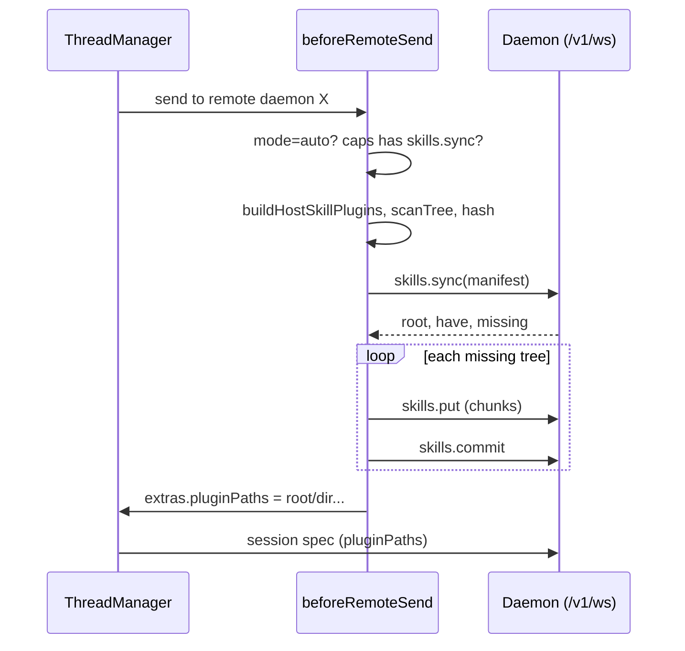

# ADR: Deliver Threads-controlled skills to remote agent-threads daemons

**Date:** 2026-10-19
**Status:** Accepted. Implemented in `feat/remote-skills-sync`. Open questions resolved: no first-sync confirmation (help text only); 14 days / 256 MiB; Off does not delete (prune handles it); existing `admin` scope; generic "update the daemon" warning without a version; failures show a thread notice. Implementation notes: a limit rejection uses `bad_frame` with a `limit:` message (no new error code); an over-limit tree is skipped whole, and a single file over 8 MiB also skips the tree (one file per frame).
**Number:** unassigned. `CLAUDE.md` says ADRs live in Compass, so this file is a repo-side draft to migrate there (under the Architecture Decision Records parent), leaving a pointer here.

## Context

Skills reach only the managed local-container daemon today. `beforeRemoteSend` (`src/main.ts`) returns early unless `daemon.managed === 'local-container'`. Otherwise it calls `localDaemonPrep.prepare()`, whose `deliverSkills` copies each plugin tree with `container exec` (`src/localDaemon/containerFiles.ts`) into `<data>/skills/<name>-<hash>`. The paths go through `extras.pluginPaths`, ThreadManager `remotePluginPaths` and `RemoteSessionSpec.pluginPaths`. The daemon then applies `keepUnder(pluginRoot = <dataDir>/skills)` in `daemon/sessionPolicy.ts` and passes `plugins:[{type:'local',path}]` to the SDK (`daemon/claudeDriver.ts`).

A plain remote daemon (for example a headless Linux box) has no `container exec`. Its only channel is `/v1/ws`. The `pluginPaths` + `keepUnder` half already works on every daemon. Only delivery is missing, and `docs/remote-daemon.md` (lines ~10 and ~828) wrongly says skills are not forwarded.

`creds.push` (admin-scoped command, audited, value-free audit trail) is the precedent for pushing data to a daemon over the WebSocket.

**Decided constraints (from the user)**
1. Scope: only skill plugin directories Threads itself controls, meaning what `buildHostSkillPlugins()` returns (vault-installed, local `/local:<id>`, GitHub or local Skills Manager sources).
2. Nothing user-level. Never write `~/.claude/*` on the remote (the local path's `syncUserDir` for `~/.claude/skills` and `~/.claude/agents` is NOT replicated). Skills land only in `<data>/skills/<name>-<hash>` and load via `pluginPaths`, so only Agent Threads sessions see them.
3. Per-daemon setting: `auto` (default) or `off`, extensible to a third mode.
4. Local-container behaviour is unchanged.

## Decision

Add a small, additive, content-addressed skill upload protocol on the existing WebSocket. The client runs it from `beforeRemoteSend` for non-managed daemons whose mode resolves to `auto`.

### Setting

`RemoteDaemonConfig.skillsSync?: 'auto' | 'off'`. Absent means `auto`. Read it only through one resolver, `resolveSkillsSyncMode(daemon)`. That resolver treats an unknown string as `off` (fail closed), and returns `n/a` for `managed: 'local-container'`, which keeps its own path. A later third mode (for example `'selected'` with a `skillsSyncSources` allowlist) is a new enum value plus a new field, with no migration. UI: Settings > Remote, in each daemon's edit modal, as a "Skills" dropdown (Automatic / Off) with the security sentence below as help text.

### Wire protocol (PROTOCOL_VERSION stays 1; additive)

All commands are `admin` scope (they write to the daemon's disk) and go through the existing idempotency cache and audit log.

| Frame | Direction | Purpose |
|---|---|---|
| `skills.sync` `{trees:[{dir, hash, files, bytes}]}` | client to daemon | Manifest of wanted trees. `dir` is `<name>-<hash12>`. `hash` is a sha256 over sorted `(path, mode, content)`, not the mtime fingerprint the local path uses, because mtimes do not survive across machines. |
| reply | daemon to client | `{root, have:[dir], missing:[dir]}`. `root` is the absolute `<data>/skills`, so the client can build absolute `pluginPaths`. It also touches `have` dirs (LRU stamp). |
| `skills.put` `{upload, dir, seq, files:[{p, m, b64}]}` | client to daemon | Chunk of one missing tree, at most ~1 MiB of payload per frame (well under `MAX_FRAME_BYTES` 16 MiB and the 4 MiB outbound budget), sent sequentially with the existing ack. Staged under `<data>/skills/.incoming/<upload>/`. |
| `skills.commit` `{upload, dir, hash, files, bytes}` | client to daemon | Daemon recomputes the hash and counts. On a match it atomically renames staging to `<data>/skills/<dir>`. On a mismatch it deletes staging and returns `bad_frame`. |

Capability `skills.sync` is added to `BASE_CAPABILITIES` and advertised in `welcome`. The client sends nothing unless it sees it.

Content addressing makes concurrent uploads of the same tree harmless: the second rename finds the target present and discards its staging. It also makes retries after a dropped socket safe, because `skills.commit` is idempotent and staging dirs are keyed by upload id.

### Daemon-side safety (never trust the client)

- `dir` must match `^[A-Za-z0-9._-]{1,80}-[0-9a-f]{12}$` and not start with `.`.
- Each file path `p` must be relative and NUL-free. It may not contain `..`, empty or `.` segments, or a backslash. A segment is at most 255 bytes and the path at most 512. Duplicate and case-folded duplicate paths are rejected.
- The resolved target must stay strictly inside the staging dir (reuse the `startsWith(base + '/')` check from `keepUnder`). Files are created with exclusive create (`wx`), and the daemon never creates symlinks or hardlinks. Parents are made with `mkdir` and re-checked with `lstat` (no symlink components).
- Modes are masked to `0644` or `0755`.
- Caps are enforced again on the daemon, matching `DEFAULT_TREE_LIMITS`: 2000 files, 20 MiB, depth 12 per tree. Added limits: at most 32 trees per sync, and a total `<data>/skills` budget (default 256 MiB), after which a commit fails with `limit`. The client enforces its own caps first and skips an over-limit tree with a warning, as the local path does.
- Client side: reuse `scanTree`, which follows symlinks on the host, skips `.git`, `node_modules` and `.DS_Store`, and enforces the limits. Only regular files go on the wire, so the daemon never has to interpret a link.
- The existing `keepUnder` check at session start remains the last gate, so a spec naming a path outside `<data>/skills` is still dropped.

### Pruning

The daemon owns pruning, not any client. Several Geode installs may share one daemon, so one client's manifest cannot define what is stale. Policy: delete `<data>/skills/*` dirs (and stale `.incoming/*`) that are not referenced by a live session's `pluginPaths` AND whose last-touched time is older than 14 days, plus a least-recently-used trim when over the total budget. Run it at daemon start and after each commit. Touching happens in `skills.sync` for `have` and in `commit`.

### Client flow and failure behaviour

- A 30 s overall budget applies. Per-daemon results are memoized by `(daemonId, epoch, hash)`, so a later send re-runs only the cheap scan and, on an unchanged tree, a single `skills.sync` round trip. A daemon restart (new epoch) invalidates the memo.
- Sessions load plugins at start. Skill edits show up on the next session start, not mid-turn.
- Offline, upload failure, over-limit tree, or a hash or limit rejection: the session still starts, with `pluginPaths` limited to trees that did land (possibly none), and a visible warning in the thread ("Skills not synced to <daemon>: <reason>"). Skill delivery never blocks a send.
- No `skills.sync` capability (old daemon): skip, with one warning per daemon per connection ("Daemon X predates skill sync; update it"). `docs/remote-daemon.md` gets the minimum daemon version once released.
- The local path today collects `extras.warnings` but I found no surface showing them (they go to `debugLog`). Implementation must add a thread-visible notice for the remote path. The local path may share it later, but changing the local path is out of scope here.
- `off`: the client sends nothing and uses no `skills.*` frames. The daemon keeps whatever was synced earlier until the LRU prune removes it. A "Clear synced skills" action is deferred (open question).

### Security note

Skills are instructions the agent follows. In `auto` mode, every skill in the vault (including third-party GitHub sources) is placed on a machine where the agent has shell access and its own Claude login. Installing a skill thus becomes a delegation of that daemon's authority. Mitigations: admin-scope token required, audit entries (`skills_sync` with dir names and byte counts, never content), a thread notice naming how many skill folders were synced, help text on the setting, and `off` per daemon. Skill trees can contain secrets (an `.env` inside a skill folder). We send them like the local path does and say so in the help text. We do not add a secret scanner in v1.

## Options Considered

| Option | Pros | Cons |
|---|---|---|
| **A. WS manifest, missing-set, chunked upload (chosen)** | Works on any daemon with only the existing channel and auth. Content-addressed (dedupe, idempotent retry). Reuses `pluginPaths` and `keepUnder` unchanged. Matches the `creds.push` precedent. | New admin-scope write path on the daemon, so it needs careful validation. Adds ~4 frames and a capability. |
| B. Inline tree in the session spec | One round trip, no new commands. | No dedupe (re-sends every session). The spec grows toward the frame cap. The policy layer would have to write files during validation. |
| C. Daemon pulls (git or HTTP) | Small client work. | Local and vault skills are not in git. The daemon needs network reachability and credentials back to the host or a registry. |
| D. rsync or scp over SSH | Mature tooling. | Needs SSH credentials per daemon, which the product does not hold. Not usable from mobile or the Geode renderer. |
| E. Write into `~/.claude/skills` on the remote | Zero daemon changes. | Rejected by constraint 2: leaks skills into the user's own Claude Code on that box. |

## Consequences

- Easier: remote threads match host behaviour for Threads-managed skills. The delivery contract becomes the same for managed and plain daemons (copy to `<data>/skills`, hand back paths).
- Harder: the daemon gains a disk-writing admin command with its own limits and pruning. Two delivery implementations (container exec and WS) coexist, and a shared `scanTree` is the common core.
- Giving up: user-level skills and agents on the remote (by decision), mid-session skill refresh, and a default that is safe-by-opt-in (default `auto` was the user's choice).
- Betting on: skills trees stay small (the 20 MiB cap fits current ones) and the remote operator is the same person as the vault owner.

## Risks

- Riskiest assumption: that `auto` as the default is acceptable for daemons the user does not fully own. If a shared or lower-trust daemon appears, revisit the default (a first-use confirmation, or `off` for non-loopback hosts). That is the third-mode slot.
- A daemon path-handling bug becomes remote file write. Mitigated by validate-then-stage-then-rename, no link creation, an `lstat` re-check, and the fuzz-style tests below.
- Clock-independent hashing costs a full read per scan. Memoize on the local mtime fingerprint, and hash only when it changes.
- A protocol ever needing `PROTOCOL_VERSION` 2 would supersede this. Not expected, since the change is additive.

What would make me revise: skills routinely exceeding the caps (switch to per-file diffing), or multi-user daemons (add per-token skill namespaces).

## Test plan

- Unit (client): `resolveSkillsSyncMode` (absent, `auto`, `off`, unknown, managed). Manifest building, dedupe of identical realpaths, hash stability, chunk splitting at the size boundary, cap-exceeded skip with warning, no-capability skip, offline and mid-upload failure leave the session startable with a warning, and the local-container path is byte-for-byte unchanged (existing `localDaemon` tests stay green).
- Unit (daemon validator, table-driven): `..`, absolute paths, backslash, NUL, empty segments, over-long names, case duplicates, a `dir` with `/` or a leading dot, and cap overflows at the boundary (2000 / 20 MiB / depth). Symlinked staging parent. Hash mismatch deletes staging. Duplicate commit is a no-op. Prune keeps dirs referenced by a live session and removes old unreferenced ones.
- Daemon integration (real `startServer` with `--fake-harness`, as in `test/unit/daemon-*.test.ts`): `welcome` advertises `skills.sync`. A non-admin token is refused. The full sync, put, commit round trip lands files under `<data>/skills`. A second sync reports `have`. A session spec with the returned paths reaches the driver's `plugins`, and a spec with a foreign path does not. A dropped socket mid-upload followed by a retry succeeds.
- Docs test: none, but `scripts/e2e-geode-remote.mts` gets one skill folder against the fake-harness daemon.

## Docs fixes (part of the implementation PR)

- `docs/remote-daemon.md` line ~10: replace "It does not have skills or keychain secrets" with the current truth (Threads-controlled skills are synced automatically unless the daemon's Skills setting is Off; no `~/.claude` content is copied; keychain secrets still are not forwarded unless that has shipped).
- Line ~828: replace "Skills and keychain secrets are not forwarded (PR 9)" the same way, and document the new frames, the capability, the caps, pruning and the setting in the protocol section.
- `process/architecture.md` key-files table: add the new client sync module and daemon store module.

## Open questions

1. Should the first `auto` sync to a given daemon show a one-time confirmation, given the security note, or is the settings help text enough?
2. Pruning age (14 days) and total budget (256 MiB): are these acceptable defaults?
3. Should `off` actively delete previously synced dirs ("Clear synced skills"), or leave them to the prune?
4. Which daemon version ships this, so the "update the daemon" warning can name it?
5. Is `admin` scope right, or should it be a narrower new scope? Today a token that can push credentials is the only kind that can write to disk.
