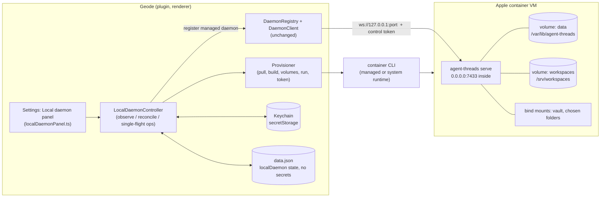
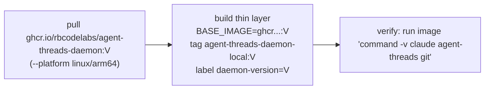
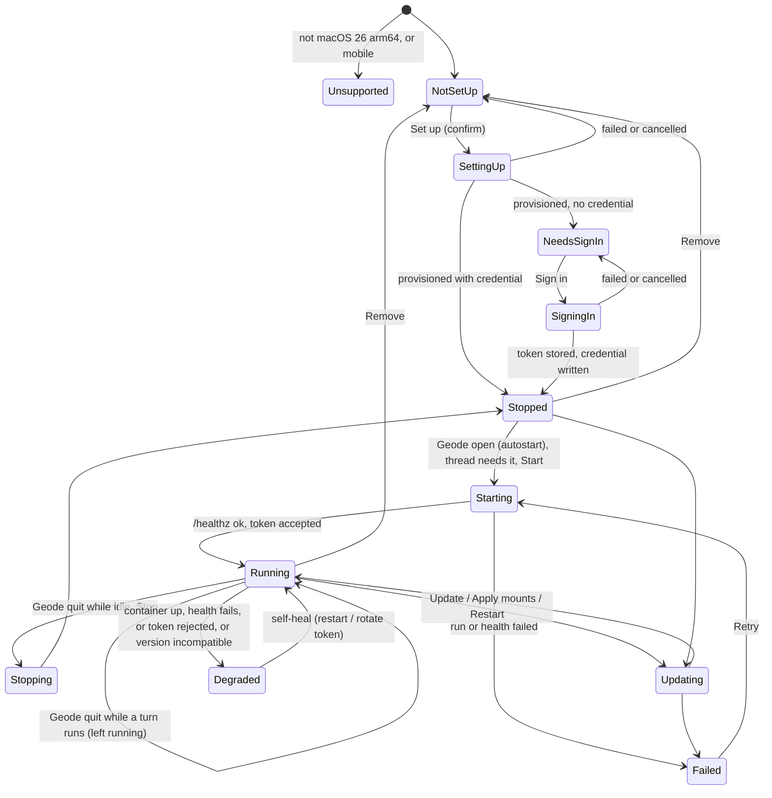

# Local daemon: design

> Update: the per-thread sandbox VMs (ADR-0015, `enter_vm`/`vm_exec`/`exit_vm`, "Run in: Container") that this design
> positions itself against, and the `sandboxVm.ts` / `sandboxImage.ts` / `harnessVmRouting.ts` modules it mentions, have
> since been removed. `sandboxVm.ts` became `containerCli.ts` (the command runner only), `buildImagePullArgs` moved into
> `src/localDaemon/spec.ts`, and `sandboxRuntime.ts` stays as the bundled runtime. Read those references as history.
> GitHub delivery, listed below as a non-goal, now exists: see `docs/github-integration.md`.

Status: proposed (design only, no code). Audience: whoever implements the PRs in section 12.
Baseline: v0.64.0 (`f2d6daa`; the commit that contains #776). Written against `git archive f2d6daa`, because the
worktree path `/Users/user/.geode/worktrees/agent-threads/feat-local-daemon` is not mounted in the sandbox
this was written from, and `/work` is a checkout of `main` at v0.63.0. Move this file into the worktree when you
commit it.

Evidence tags used throughout:

- **[V]** verified by hand on the user's Mac (container 1.5.0, macOS 26.4.1), as reported in the brief.
- **[C]** verified by reading code at v0.64.0 (file named).
- **[U]** not verified. Every [U] is collected in section 13 as a spike to run before the PR that depends on it.

## 1. Problem and goal

Today the only way to run the daemon (`docs/remote-daemon.md`) is on another machine, with manual steps: pull or
build an image, pick volumes, create a token, paste the token into Geode, give the daemon a Claude credential,
sometimes expose it with Tailscale. The user wants the daemon to run **on the same Mac, automatically, inside Apple's
`container` runtime**, set up with one click like "Set up sandbox", with no token pasting, no separate Claude
sign-in step beyond what already exists, and no docker commands.

What success enables that failure does not: a thread that keeps running when Geode quits and re-attaches on
reopen (the daemon's journal and replay), inside a VM boundary, on a laptop with nothing else to operate.

Non-goals (v1):

- Exposing the local daemon to other devices (Tailscale, LAN). It binds the Mac's loopback only.
- Replacing user-managed remote daemons. A local daemon is one more entry in "Remote daemons", marked managed.
- Codex/OpenCode were out of scope for v1 (the daemon was Claude only). They are now optional per-harness toggles: section 4.5.
- GitHub credentials, skills and keychain secrets inside the daemon. Same gaps as any remote daemon today [C].
- Stop-on-idle by timer (section 5.3).
- Intel Macs, macOS < 26, Linux, Windows, mobile.

## 2. Options considered (the shape of the feature)

| Option | Pros | Cons |
|---|---|---|
| **A. Managed daemon container** (recommended) | Reuses 100% of the remote path (`DaemonClient`, journal, resync, host tools). VM boundary. Survives Geode quit. Image is already published per release [C publish-daemon-image.yml] and the thin Claude layer pattern exists [C Dockerfile.daemon] | Most moving parts (image, volumes, mounts, token, credential, lifecycle). Another ~GB VM on the Mac |
| B. Run `dist/agent-threads.cjs` as a host process spawned by Geode | No runtime, no image, trivial lifecycle | No isolation: the agent is a host process, which a local thread already is. Gains only "survives quit", and then needs launchd to be robust. Not what was asked |
| C. Extend VM-routed harness (ADR-0015) so threads survive quit | One container concept | The harness process is a child of the plugin's SDK `query()`; it dies with Geode. Making it survive means rebuilding the daemon's journal/replay inside the plugin. Rejected |

Positioning to be decided (open question 1): after this ships there are two container modes, "Run in: Container"
(per-thread, ADR-0015, dies with Geode) and "Run on: This Mac (container)" (shared daemon, survives Geode). The UI must
make the difference one sentence.

## 3. Verified facts and what they imply

| Fact | Tag | Consequence for the design |
|---|---|---|
| `ghcr.io/rbcodelabs/agent-threads-daemon:0.64.0` pulls unauthenticated | V | No registry login. Failure mode "package private" still needs a clear error (section 9) |
| Existing pull pins `--platform linux/arm64` because a bare multi-platform pull unpacks every platform | C sandboxImage.ts `buildImagePullArgs` | Reuse `buildImagePullArgs` as is |
| `container build -f sandbox/Dockerfile.daemon --build-arg BASE_IMAGE=... .` works | V | In the plugin there is no repo checkout, so embed the thin layer as a string constant (the `HARNESS_DOCKERFILE` pattern) and test it for drift against the `with-claude` stage (section 4.4) |
| Named volumes are root-owned; the daemon dies with `EACCES mkdir /var/lib/agent-threads/journal` | V | A one-shot `run -u 0 --entrypoint ...` fixes ownership to uid 10001 before first start |
| `run -d -p 127.0.0.1:7433:7433` publishes the port; `/healthz` answers from the Mac | V | Readiness probe is `GET /healthz` from the plugin, not the (probably ignored) Dockerfile HEALTHCHECK [U] |
| `token create` shows the token once | V | Daemon has `--json`: prints one JSON line `{id,name,scope,token}` [C daemon/cli.ts:195]. No scraping of the human format |
| `doctor` FAILs without a Claude credential | V | `serve` still starts and answers `/healthz`; credential is a separate readiness axis, not a start precondition |
| The daemon reads `CLAUDE_CODE_OAUTH_TOKEN` or `$CREDENTIALS_DIRECTORY/claude-token` **once at start** | C daemon/claudeDriver.ts `resolveCredentialEnv`, server.ts:122 | Rotating the credential needs a daemon restart. A file credential avoids putting the token in `container run` argv or `container inspect` (section 6) |
| Workspaces are fixed at `serve` start (`--workspace`, flag > env > config.json) | C daemon/config.ts | Changing mounts means recreating the container (mounts are fixed at `run` anyway) |
| `welcome` carries `daemonVersion`, `minClientVersion`, `protocol`; the plugin refuses only when protocol differs or plugin < `minClientVersion`; today `MIN_CLIENT_VERSION = '0.0.0'` | C DaemonClient.ts:497, daemon/version.ts | There is **no** check that the daemon is new enough for the plugin. The local-daemon module must add one (section 8) |
| Sign-in runs `setup-token` in a named container via `/usr/bin/expect`, takes `containerName` and `containerBinaryPath`, returns an `sk-ant-oat...` token, which is stored under `CONTAINER_AUTH_TOKEN_SECRET` | C claudeContainerAuthCli.ts, main.ts:2676 | Reusable for the daemon container (`/opt/claude/.local/bin/claude`). The flow includes pasting an OAuth code (`onCodePrompt`); that cannot be removed with this mechanism (open question 4) |

## 4. Architecture

### 4.1 Component view



The daemon itself is unchanged. The new surface is plugin-side only, plus (optionally, later) small daemon additions
listed in section 14, PR 11.

### 4.2 Module split (pure vs Geode-only) and the closure rule

Rule from `process/architecture.md` and #776: the "core" is the runtime import closure of `ThreadManager`,
`ThreadSession`, `ClaudeSession`, `CodexSession`, `OpenCodeSession`, `Scheduler`, `HarnessFactory`, and
`protocol/index.ts`; it must run in plain Node (the daemon bundles it) and `core-files.json` +
`tsconfig.core.json` must match it exactly. #776 was not a violation, it was **drift**: #764 added imports that
pulled three Node-only files into the closure without regenerating the manifest, so `core-boundary` and
`daemon-boundary` failed on main [C commit 03cb447].

Consequences for this feature:

1. All new code lives in a new directory `src/localDaemon/`, imported only by `main.ts` and `SettingsTab.ts`
   (and the panel). Nothing in the current closure may import it. The closure then does not change and
   `core-files.json` needs no edit.
2. **Do not add imports to closure files** (`sandboxVm.ts`, `sandboxRuntime.ts`, `sandboxImage.ts`,
   `harnessVmRouting.ts`, `types.ts`). New helpers go in new files. Type-only additions to `types.ts` (the
   `managed` field, section 7) do not change the runtime graph [C core-closure elides type-only imports].
3. If a PR does touch a closure file's imports, its checklist is: `npm run core:update`, commit
   `core-files.json` and `tsconfig.core.json`, run `npm run check:core`. This is the step #764 missed. Add it
   to the `pr-checklist` guidelines for this feature.
4. Mobile: the plugin bundle loads on mobile, where `require()` of Node builtins returns null. New modules must
   `require('child_process' | 'fs' | 'os' | 'path' | 'net')` only inside functions, as `sandboxVm.ts` and
   `sandboxImage.ts` do [C]. All process spawning goes through `VmCommandRunner`.

| Module (all new) | Pure? | Responsibility |
|---|---|---|
| `src/localDaemon/spec.ts` | pure | Constants (names, labels, ports, image refs, mount rules), `THIN_DOCKERFILE`, argv builders for every `container` call, `specSignature()` (hash of everything that is fixed at `run`) |
| `src/localDaemon/parse.ts` | pure | Parse `container ls/inspect --format json`, `token create/list --json` (NDJSON), pull/build error classification (denied, not found, network, disk) |
| `src/localDaemon/assess.ts` | pure | `assess(observed, desired) -> {status, actions[]}`; the version rule; no I/O, no clock |
| `src/localDaemon/view.ts` | pure | Status to labels, button states, disclosure text, error text (the `sandboxSetupView.ts` role) |
| `src/localDaemon/provision.ts` | injectable I/O | Runs actions through a `VmCommandRunner`; single-flight, abortable, progress callback (the `sandboxSetup.ts` role) |
| `src/localDaemon/controller.ts` | injectable I/O | Owns observe-then-reconcile, start/stop/restart/reset/remove, health probe, token mint, registry registration, via injected deps (`runner`, `probe`, `secrets`, `settings`, `registry`) |
| `src/localDaemon/localDaemonPanel.ts` | DOM, jsdom-testable | Settings block and sign-in banner, deps injected like `sandboxSetupPanel.ts` |
| `main.ts` / `SettingsTab.ts` edits | Geode-only | Construct the controller with real deps (`app.secretStorage`, `Platform`, `saveSettings`, `daemonRegistry`), unload hook, commands |

Refactor needed first (PR 1): `sandboxSetup.ts` `execute()` inlines the runtime install + start steps (1 and 2).
Extract them into an exported `ensureRuntimeReady({signal, report, deps})` with identical behavior and error mapping,
and have `execute()` call it. The local-daemon provisioner then reuses runtime install, progress, cancel and the
"supported Mac" check without copying them. `sandboxSetup.ts` is not in the core closure, so this does not touch the
manifest [C core-files.json].

### 4.3 Container spec

One container per vault. Name `agent-threads-local-<vaultHash8>` (hash of the vault's absolute path), so two vaults or
two Geode windows never fight over a name or a port. Volumes `agent-threads-local-<vaultHash8>-data` and
`-workspaces`. Labels:

| Label | Use |
|---|---|
| `com.rbcodelabs.agent-threads.local-daemon=1` | ownership: the orphan sweep and adoption only ever touch labelled containers |
| `...daemon-version=<x.y.z>` | which release this container was created from |
| `...spec=<sha256 prefix>` | hash of the `run` argv inputs (mounts, port, memory, cpus, workspace list). Drift means "recreate to apply", the same idea as `mountSignature` in `skillMounts.ts` [C] |
| `...vault=<hash>` | which vault owns it |

`run` argv, in words (the exact argv is a golden test in PR 2):

- `--detach --name <n> --label ...`
- `--publish 127.0.0.1:<hostPort>:7433` [V form]; the internal port stays 7433 so the image's defaults hold. Host port: 7433 preferred, else next free; the choice is stored in `localDaemon.port`.
- `--volume <data>:/var/lib/agent-threads --volume <ws>:/srv/workspaces`
- one `--volume <hostPath>:<guestPath>[:ro]` per mount (section 7.2); host paths containing `:` are refused (the runtime treats it as the delimiter [C docs/sandbox-vms.md])
- `--memory` / `--cpus` (defaults reuse the sandbox's 4G/4 until open question 6 is answered)
- `--env CREDENTIALS_DIRECTORY=/var/lib/agent-threads/creds` (a path, not a secret)
- image `agent-threads-daemon-local:<version>`, then the replaced `CMD`: `--listen 0.0.0.0 --i-know-this-is-open --workspace /srv/workspaces --workspace <each mount>`. The image's `CMD` already carries the first three [C Dockerfile.daemon], and a replacement `CMD` must repeat them.
- No `--restart` flag is assumed. Apple's CLI restart policy is [U]; the design assumes **none** and treats "container stopped" as normal (host reboot, runtime restart).

Security properties of this spec that the tests pin: loopback-only publish string, no `--privileged`/capability adds,
no token or secret anywhere in argv, no `--network` override (full egress, same default as the sandbox, by the same
product decision [C docs/sandbox-vms.md]).

### 4.4 Image pipeline

(Harness toggles, section 4.5, make the layer below depend on the enabled set; Claude only is exactly what is described here.)



- Tag = plugin `manifest.version` exactly (published tags are `0.64.0` without `v` [C workflow]). The local tag keeps the
  version, so an update never overwrites the running image.
- `THIN_DOCKERFILE` is the `with-claude` stage of `sandbox/Dockerfile.daemon` plus `ARG BASE_IMAGE` / `FROM ${BASE_IMAGE}`,
  written to a temp dir and built with that dir as context. The multi-stage file cannot be reused as is: its `builder`
  stage `COPY`s `src/` and `daemon/`, which do not exist in the plugin install. [V] shows the full file builds from a checkout; the
  trimmed one is [U] (spike).
- Drift test: extract the `with-claude` stage from the real `sandbox/Dockerfile.daemon` and assert it equals the
  constant (same idea as the byte-equality test for `HARNESS_DOCKERFILE` [C sandboxImage.test.ts:99]).
- The Claude CLI is installed at build time from Anthropic on the user's machine; the published image deliberately has
  no CLI (no redistribution grant) [C]. The confirmation dialog says so, as the sandbox one does.
- Pull/build are long, chatty and abortable: reuse the runner options `onOutput`, `signal`, `maxBufferBytes`, timeouts
  `SANDBOX_PULL_TIMEOUT_MS` / `SANDBOX_BUILD_TIMEOUT_MS` [C].

### 4.5 Harness toggles (Claude, Codex, OpenCode)

`LocalDaemonSettings.harnesses` (absent = `['claude']`) holds which agent CLIs the user turned on. It drives four things:

- **Image.** `thinDockerfileFor(set)` composes the layer: `ARG BASE_IMAGE` / `FROM`, then the `with-harnesses` stage body of
  `sandbox/Dockerfile.daemon` if Codex or OpenCode is on (build args `INSTALL_CODEX=1` / `INSTALL_OPENCODE=1`; npm into
  `/opt/harnesses`, outside the volumes; `--allow-scripts=opencode-ai` because npm 11 blocks dependency install scripts and
  `opencode-ai`'s postinstall links its binary; `--version` calls fail the build if a CLI is not runnable), then the `with-claude`
  body if Claude is on. Claude only is byte for byte the old `THIN_DOCKERFILE`. **Pin test:** both stage bodies are embedded
  verbatim and compared with the real file (`WITH_CLAUDE_STAGE_BODY` as before, plus `WITH_HARNESSES_STAGE_BODY`); the Dockerfile
  keeps `with-harnesses` before `with-claude` so the default target and the Claude body are untouched.
- **Image tag.** `localImageRef(version, set)` keeps `agent-threads-daemon-local:<version>` for Claude only and appends the set
  (`-claude-codex`) otherwise, so changing a toggle can never reuse a stale layer and the existing tag is unchanged for current users.
- **Spec signature (drift).** `specSignature` hashes the image ref and, for a non-default set only, the set. A Claude-only
  container made before this existed therefore does not read as drifted after an upgrade. A toggle makes the signature differ:
  stopped, `assess` plans `remove-container`, `pull-image`/`build-image` (new tag not built yet), `prepare-volumes`,
  `create-container`; running, it reports `drift` and the panel offers **Apply changes** (the existing `update` operation, which
  builds the image for the current set and replaces the container, keeping the volumes). The version rule (section 8) is unchanged.
- **Daemon allowed set.** `--env AGENT_THREADS_HARNESSES=<set>` on `run`, so a session for a harness that is off is refused by
  the daemon's policy. With Claude off nothing waits for a Claude credential (`needsSignIn` and `credential-not-applied` apply
  only when Claude is on).

State is observed, not stored: while the container runs, one `exec` (`HARNESS_PROBE_SCRIPT`) reports `<h>.cli=0|1` (executable in
the image) and `codex.auth` / `opencode.auth` (a non-empty login file in the persisted HOME; sizes only, never contents).
Claude's sign-in stays the existing credential file / keychain signal. The panel renders the probe per harness and says
"unknown" when there is no probe (stopped, or the probe failed).

**Logins (extends 6.2).** Codex: `codex login --device-auth` via `container exec` (`harnessLogin.ts`): it prints a URL and a
one-time code, polls until approved and writes `~/.codex/auth.json` itself, so there is no paste-back and no pty; Geode relays
the URL/code, then re-probes to confirm a login really landed (a "success" with no login is reported as a failure). The
credential lives only in the data volume (the daemon user's HOME), so it persists across restarts, updates and container
replacement, is removed by Reset, and never touches settings, the keychain, argv or logs; errors are token-redacted. OpenCode:
`opencode auth login` is an interactive provider picker, so the panel shows the exact `container exec -it ...` line (managed
`container` path quoted) instead. Every failure path includes the matching manual command. **Unverified [U]:** the device flow
over a non-tty `container exec` and the exact CLI output format were not run live (no Mac runtime or Docker on the build host);
the parser (`parseDeviceLogin`) is tolerant and the failure path degrades to the manual command. The Dockerfile stage was also
not built here.

## 5. State machine and lifecycle

### 5.1 Approach: observe, then reconcile

Do not keep a hand-maintained state variable that can disagree with the world (Geode crashed, user ran `container rm`,
runtime restarted). Persist only intent (`enabled`, port, mounts, versions provisioned) and **derive status from
observed facts** each time it is needed:

```
observed = {
  supported, runtimeInstalled, runtimeRunning,
  imageThin(version|missing), volumes(present|missing),
  container(absent | stopped | running) + its labels (version, spec),
  health(ok|down|n/a), daemonWelcome(version, protocol)|none,
  tokenInKeychain, tokenAccepted(yes|no|unknown),
  credentialInKeychain, credentialFileInVolume(yes|no|unknown)
}
desired  = { enabled, pluginVersion, specSignature, autostart }
assess(observed, desired) -> status + ordered, idempotent actions
```

`assess` is a pure total function with a table-driven test over the fact space. This also meets the repo rule to
prefer native mechanisms over timers for lifecycle bugs [C CLAUDE.md]: there is no "starting for N seconds"
heuristic. The only wait is a bounded readiness poll of `/healthz` after `run`, which is waiting on an event we caused.

### 5.2 Status diagram



`Degraded` and `Failed` carry a typed reason (section 9) so the panel shows a specific fix rather than "error".

### 5.3 Lifecycle edges (and why no idle timer)

| Edge | Behavior |
|---|---|
| Plugin load (after layout ready, non-blocking) | If `enabled && autostart`: observe; **adopt** a running labelled container (Geode crash, reload); else start it. Never blocks plugin load; failures surface in the panel and the Run-on picker, not as a modal |
| Thread start with Run on = local daemon | `ensureRunning()`; if it needs more than a start (image, sign-in), the picker row shows the status and links to Settings. A running turn is never started on a half-ready daemon |
| Plugin unload / quit | Ask the daemon (`DaemonClient`, `list`-equivalent: `turnInFlight`, `hasPendingPermission`). Nothing in flight: `container stop` (graceful, the daemon flushes journals on SIGTERM, compose uses a 30 s grace [C]). Something in flight: **leave it running**; that is the product value. The next open adopts it. A stop that cannot finish is harmless: same adoption path |
| Idle while Geode stays open | v1: none. The daemon already reaps idle `claude` processes (`idleReapMinutes`, default 30 [C config.ts]); the VM staying up costs memory, not tokens. A real stop-on-idle needs a daemon-native "nothing running" signal (PR 11) polled at the existing low-frequency sweep, not a new timer. If the user insists on a v1 timer, say so explicitly as the fallback |
| Mac reboot / runtime restart | Container is stopped (no restart policy assumed). Autostart handles it on next Geode open |

The onunload caveat: `onunload()` is not awaited by the host [C main.ts comments at 1526]; a `container stop` child
may be killed mid-flight with the renderer. Spike U9 decides whether to spawn it detached; the failure mode is safe either way.

## 6. Token and credential

### 6.1 Control token (plugin to daemon)

- Created **inside** the container after `/healthz` is ok:
  `container exec --user 10001 <name> agent-threads token create --name geode-local --scope control --json --data-dir /var/lib/agent-threads`.
  Parse the single JSON line from stdout; never log stdout of this command; never put the token in argv. `--data-dir`
  and `--user` are passed explicitly because whether `container exec` inherits the image `USER` and `DATA_DIR` env is [U].
- Idempotent and crash-safe order: list tokens (`token list --json`, NDJSON, one object per line [C cli.ts:212]); revoke any existing `geode-local` that
  the keychain does not have a secret for; create; **write to the keychain immediately**; if the keychain write fails, revoke the new token and fail. An
  orphan from a crash between create and store is revoked on the next setup because it is found by name.
- Stored in the OS keychain under `tokenSecretNameFor('<id>')` [C daemonConfig.ts], like any daemon token; nothing in `data.json`.
- Scope `control`: all Geode needs; `admin` adds nothing Geode uses [C docs].
- Registered as a `RemoteDaemonConfig` with `url: ws://127.0.0.1:<port>`, `name: 'This Mac (container)'`, and a new additive
  optional field `managed?: 'local-container'` (type-only in `types.ts`). The Remote daemons list shows it with a badge;
  Edit permits host-tool settings only (URL and token are locked); Remove routes to the local-daemon Remove flow.
  `plainTransportWarning` already treats loopback as fine [C].
- Container recreate does not change the token (it lives in the data volume). If `DaemonClient` reports `unauthorized` after a recreate or a volume reset, `assess` plans
  "rotate token". "Reset daemon data" always rotates.
- Threat note: any process on the Mac can reach `127.0.0.1:<port>`; `/healthz` is unauthenticated, everything else needs a 256-bit token [C docs/Security]. Same-user malware that can read the keychain already has more than the daemon offers. Whether Apple's publish also listens on non-loopback interfaces despite the `127.0.0.1:` prefix is [U] and is spike U3 (test from another device on the LAN); if it does, this feature is blocked until fixed.

### 6.2 Claude credential (daemon to Anthropic)

Order of preference, none needing the user to type a token:

1. Keychain already has `CONTAINER_AUTH_TOKEN_SECRET` (`CLAUDE_THREADS_CONTAINER_OAUTH_TOKEN`) because the user signed in for VM-routed threads [C]. Use it. Zero clicks. The secret is global, not project-scoped, by existing design [C main.ts:2661].
2. Otherwise status `NeedsSignIn`. The panel offers **Sign in to Claude**, running the existing `signInToClaudeInContainer` against the daemon container with `containerBinaryPath = /opt/claude/.local/bin/claude` [C Dockerfile.daemon] and the same banner component (`renderClaudeSignInBanner`). A thread-free `storeContainerAuthToken(token)` is split out of `persistContainerAuthToken(threadId, token)`, which today also restarts a thread session [C main.ts:2676]. The daemon container must be running for this (it starts without a credential [V]).
3. A host `claude` login in the macOS keychain cannot be reused inside a Linux VM [U but near-certain]. So "no separate sign-in" holds only when (1) applies; otherwise there is exactly one browser sign-in plus the code paste inherent to `setup-token` (open question 4).

How the token reaches the daemon (options):

| Option | Pros | Cons |
|---|---|---|
| `--env CLAUDE_CODE_OAUTH_TOKEN=...` on `container run` | Simplest. Precedent: ADR-0015 passes secrets as `--env` on `exec` [C] | Visible in host `ps` argv and in `container inspect`; token rotation needs a recreate |
| `--env-file` 0600 temp file | Not in argv | Flag support is [U]; still in `inspect`; temp file on disk |
| **File credential in the data volume** (recommended) | Not in argv, not in `inspect`, persists across recreates, rotation = rewrite + restart, uses a mechanism the daemon already supports (`$CREDENTIALS_DIRECTORY/claude-token`) [C] | Plaintext in the volume (as is the `claude` login in `home/` in any layout). Needs a one-shot with stdin |

Recommended mechanics: a single one-shot `container run --rm -i -u 0 --entrypoint sh -v <data>:/var/lib/agent-threads -v <ws>:/srv/workspaces IMAGE -c '...'`
that (a) `chown`s the two mount points to 10001 (non-recursive, only on first creation, so it never walks a big workspace
volume), (b) `umask 077`, creates `creds/`, and writes `claude-token` from **stdin** (the runner already supports `input` for secrets [C
VmCommandRunOptions.input, used by githubVmDelivery]), (c) chowns it. Stdin on a non-TTY `run -i` is [U] (spike U5). Rotation:
stop the container, run the one-shot again (a volume cannot be assumed attachable twice [U]), start. Since the daemon reads the
credential only at start [C], that restart is required anyway.

Gap to flag, not fix in v1: if the token expires or is revoked later, the Claude process fails inside the daemon. `RemoteHarnessSession` has no
auth-failure handling [C: no auth references], and the existing sign-in banner picks its flow via `resolveClaudeVmRoutingForSignIn(threadId)`, which for a remote
thread would choose the **host** flow and sign in on the wrong machine. PR 10 routes remote auth failures to the local-daemon sign-in. Until then the
panel shows a "Claude credential" row and the user can re-run Sign in there. Whether the daemon surfaces a distinguishable auth error is [U] (spike U8).

## 7. Mounts and the vault-mount security tradeoff

### 7.1 Path mapping

Two ways to expose a Mac folder at a path the daemon uses:

| Option | Pros | Cons |
|---|---|---|
| **Identity mounts** (recommended): mount `/Users/user/Vault` at `/Users/user/Vault` | Paths in transcripts, tool output and git worktree pointers are valid on both sides; file links keep working; `vaultMapping` is `localRoot = remoteRoot` | Creating mount points under `/Users/...` in the guest is [U]; paths with `:` refused |
| Neutral mounts (`/srv/vault`, `/srv/mounts/<slug>`) | Predictable, matches docs for Linux daemons | Every path the agent prints is wrong on the Mac; existing `vaultMapping` supports only one vault mapping [C types.ts], so extra folders need a new mapping feature |

Registration sets `vaultMapping { remoteRoot: <vault path> }`; `workspaces.list` marks it `kind: vault` because it has a
`.geode`/`.obsidian` directory, so the existing auto-pick fills the dropdown [C docs "Folders are discovered"].
Extra folders are added by the user from a list in the panel (a folder picker; no automatic mounting of the home directory).
Mounts and `--workspace` list are one unit: changing either is "Apply", which recreates the container.

### 7.2 Decision: the vault mount

The sandbox mounts the whole vault read-write at `/vault`, by explicit product decision and with documentation [C
docs/sandbox-vms.md]. The daemon differs in ways that matter: it is **long-lived, shared by every thread, and survives
Geode**, and the agent in it has full network egress.

Finding to act on regardless of this feature: a read-write vault mount includes `<vault>/.geode/plugins/claude-threads/main.js`
and the other plugins' code. A process in the VM that rewrites a plugin's JS gets code execution on the **Mac** the
next time Geode loads plugins. The existing sandbox mount (no exclusions [C sandboxVm.ts resolveVaultMount, `VM_VAULT_MOUNT`]) has the same hole, so the VM is not a boundary for the vault
today. (A repo's `.git/hooks` is the same class of issue, inherent to letting any agent work in a repo, host or VM.)

| Option | Vault threads | Escape surface | Notes |
|---|---|---|---|
| 1. Whole vault rw (sandbox parity) | Work, live, no sync lag | Plugin/config tampering, any note deleted | Simple; inherits the sandbox's stated stance |
| 2. Whole vault read-only (`:ro`) | Can read, cannot edit notes | None to the host | Real enforcement, unlike `--readonly-workspace`, which only removes edit tools and not `Bash` [C docs] |
| **3. Vault rw with config directories masked** (recommended if the spike passes) | Work | Notes writable; `.geode`, `.obsidian` not | Nested mounts over `<vault>/.geode` and `<vault>/.obsidian` read-only (or tmpfs). Nested mounts over a virtiofs parent are [U] (spike U4) |
| 4. Vault not mounted by default; opt-in per vault | Vault threads unavailable until enabled | Only if enabled | Safest default, worst out-of-box |

Recommendation: option 3 if U4 passes; if it fails, option 4's default with an explicit disclosure on enabling option 1, and a separate
issue to apply the same masking to the sandbox. In all cases: the disclosure text in the Set up confirmation names the exact folder
and says "read-write", mounts are listed in the panel with a visible rw/ro badge, per-folder read-only is allowed (this is the only real read-only), and "keep vault
backups or sync history" is repeated from the sandbox docs. Also unverified: that uid 10001 can write files owned by the Mac user on a bind mount (the sandbox's `node` uid 1000 can, per its
docs, which suggests permissive ownership mapping; spike U1). If not, fall back to running the container user as the mount's mapped uid.

## 8. Version match: plugin and daemon image

Facts: the image is published on the same `v*` tag as the plugin release but by a separate workflow that builds two
platforms and smoke-tests [C], so the plugin can be installed (BRAT, auto-update) minutes before its image exists. The daemon's `minClientVersion` protects an old
plugin from a new daemon only [C], and is `0.0.0`.

Rule (pure function `assessDaemonVersion(pluginVersion, welcome)` in `assess.ts`):

| Condition | Result |
|---|---|
| `welcome.protocol != PROTOCOL_VERSION` | **incompatible**: must update (plugin refuses anyway [C]) |
| `plugin < welcome.minClientVersion` | **incompatible**: tell the user to update the plugin (existing message [C]); never auto-downgrade the image |
| `welcome.daemonVersion < MIN_LOCAL_DAEMON_VERSION` (new constant in the plugin, bumped only when the plugin starts requiring a newer daemon) | **incompatible** |
| `welcome.daemonVersion == plugin version` | **current** |
| otherwise (older but allowed) | **update-available**: works, banner offers Update; features gate on `welcome.capabilities` as for any remote daemon [C workspaces.list fallback] |

Image selection is always the plugin's exact version. If that tag cannot be pulled yet (404/manifest unknown), the status is
`update-pending` ("the daemon image for this version is not published yet; keep using <old>"), the running older-but-compatible daemon keeps working, and
the check re-runs on the next observation (open, panel open, Retry), not on a timer. Do not widen the rule to "any older daemon is fine"
without `MIN_LOCAL_DAEMON_VERSION`, or a breaking additive-protocol change has no place to be enforced. Also consider bumping the daemon's
`MIN_CLIENT_VERSION` deliberately when a plugin-side change requires it (separate decision).

## 9. Failure modes

| Failure | Detect | User sees | Recovery |
|---|---|---|---|
| Unsupported (Intel, macOS < 26, mobile, Linux) | `isRuntimeSupported` [C] / `Platform.isMobile` | Block hidden on mobile; reason text on desktop (same as sandbox) | none |
| Runtime missing or stopped | `getRuntimeStatus` [C] | Folded into the normal setup/start steps (install is ~118 MB, confirmed) | `ensureRuntimeReady` |
| Not enough disk | free-space check [C `RUNTIME_MIN_FREE_BYTES`], pull/build error text | Names the step | Free space, Retry |
| Pull denied or 404, package private | Classify stderr: `denied|unauthorized|403` vs `not found|manifest unknown|404` | "Image is not publicly pullable" vs "image for vX is not published yet" | Maintainer sets package Public (release checklist item, already noted in `Dockerfile.daemon`/workflow summary [C]); user can retry later. No registry credentials in v1 (open question 7) |
| Pull network failure | exit code + tail | "Could not reach ghcr.io" | Retry; partial layers are cached |
| Build fails (CLI download: Claude installer, npm for Codex/OpenCode) | build exit, tail | "Adding the agent CLIs to the daemon image (installs ...)" | Retry; verify step asserts every enabled CLI exists; the Dockerfile stage fails if `codex`/`opencode` is not runnable |
| Port in use | `probeHostLoopbackPort` [C vmPortForward.ts] before `run`, and `run` error text | Auto-picks the next free port and tells the user; if the occupant is our own labelled container, adopt it | Stored in settings; recreate to apply |
| Name conflict / stale container | `container ls -a` by label | none (handled) | Labelled + same spec: adopt/start. Labelled + different spec: recreate. Unlabelled with our name: refuse, never delete a container we did not create |
| Volume `EACCES` (chown skipped or wrong uid) | daemon exits; `logs` tail | "The daemon cannot write its data folder" | Re-run prepare one-shot; Reset data |
| Health never ok | bounded `/healthz` poll after `run`, then `container logs` tail | Failed with the log tail | Retry / Reset |
| Token rejected | `DaemonClient` state `unauthorized` | "Reconnecting with a new token" | Rotate token automatically; if that fails, Reset data |
| Codex / OpenCode not signed in, or CLI missing from the image | harness probe (`exec`) | Per-harness row: "not signed in" with a Sign in button (Codex) or the exact command (OpenCode); "CLI is not in the image yet. Apply changes" | Sign in / run the command / Apply changes |
| No Claude credential | status `NeedsSignIn`; `doctor --json` in the container as a hint [C doctor.ts; sees the exec environment, so a hint only] | "Sign in to Claude" | Sign-in flow |
| Daemon older/newer than plugin | section 8 | Banner: Update / update the plugin | Update |
| Runtime service dies while running | next observation: runner fails or `health down` | Degraded | Start runtime, restart container |
| Geode crash / reload with container left running | label adoption | none | automatic |
| Mac sleep/wake with a socket open | `DaemonClient` reconnect ladder [C] | existing pills | automatic |
| Mount path vanished/unmounted volume | `run` error; mount check at observe | Names the folder | Remove it from the list |
| `container stop` times out | exit/timeout | "Stopped late" note | `container rm --force` only for a labelled container, after confirm |

## 10. Upgrade, reset, remove

- **Update** (explicit button; never silent, because it downloads hundreds of MB): pull new base, build thin layer, verify; stop the container
  (warn first if turns are in flight: a restart closes them as `daemon_restarted` and the next message resumes the same native session [C docs/Upgrade]); remove the container
  (not the volumes); `run` the new one with the same volumes and mounts; verify `welcome.daemonVersion == plugin`; remove the previous local image tag. The plugin never moves an image **down** (journals
  are the daemon's format). Auto-update is open question 5.
- **Apply** (mounts, port, memory): same as Update without the pull.
- **Restart**: stop + start the same container.
- **Reset daemon data**: confirm; stop; remove container and both volumes; re-prepare; rotate token; credential is re-written from the keychain. Threads that ran there stay in the transcript but cannot resume their native session (journals and sessions are gone) [C docs/Uninstall wording].
- **Remove local daemon**: confirm; stop; remove container, optionally volumes (checkbox, default remove), optionally images; delete the keychain token (`''` as the Remote daemons Remove does [C SettingsTab.ts:3270]); drop the registry entry and `localDaemon` settings. Does **not** delete `CONTAINER_AUTH_TOKEN_SECRET` (shared with VM-routed threads).
- Everything is under one single-flight lock (the `sharedRun` pattern [C sandboxSetup.ts]): a second click joins or is refused, Cancel aborts the runner.

## 11. Mobile and unsupported hiding

Settings block rendered only when `Platform.isDesktopApp`; on mobile nothing renders (not even a heading), matching
`isMobile` handling in `renderSandboxSettingsPanel`. On desktop, `isRuntimeSupported` failure renders the reason and no buttons. The "Run on"
picker lists the managed daemon only while its status is `Running`; otherwise the row is absent on mobile, and elsewhere shows a disabled row naming the status. No
Node builtin is required at module scope (4.2 rule 4). A mobile plugin that has `remoteDaemons` containing the managed entry (synced data.json) shows it as unreachable like any
loopback daemon; the connection pill already handles that [C connectionPill.ts]; hide `managed` entries entirely on mobile, because loopback means nothing there. Settings sync of `localDaemon` is harmless: it contains no secrets, but port and vault-hash are per-device, so the state is keyed by a device id, not by vault alone [U: how data.json is synced between a user's devices is not verified].

## 12. Test plan

Layers, cheapest first:

1. **Pure unit tests** (vitest, no I/O): golden argv for each builder, including "no secret in argv", "publish string is loopback", "host path with `:` refused"; `specSignature` stability; parsers against **fixtures captured from the real CLI on the user's Mac** (`ls`/`inspect` JSON, pull error stderr for denied/not-found, `token create --json`, NDJSON `token list`); `assess` table-driven over the fact space with invariants (exactly one status; applying the plan and re-observing yields an empty plan; `Unsupported` wins; a foreign container is never acted on); the version rule table; `THIN_DOCKERFILE` drift test.
2. **Fake `container` binary** (`test/helpers/fake-container.mjs`, a Node script with state in a temp JSON file): implements `system status|start`, `image pull|inspect|ls|tag|rm`, `build`, `volume create|ls|rm`, `run` (including the one-shot and `-i` stdin), `exec`, `ls`, `inspect`, `stop`, `rm`, `logs`. Failure injection by env (`FAKE_CONTAINER_FAIL=pull:denied|pull:404|run:port-in-use|exec:token`). Used through `createDefaultVmCommandRunner(binary)` [C: it accepts a binary path], so spawn, stdin `input`, abort and timeout are the real code paths. Covers the provisioner and controller end to end, including crash-resume cases (kill between token create and keychain write; container left running; stale labelled container; port taken by a non-labelled listener on a real ephemeral socket).
3. **Real daemon without a container**: start `node dist/agent-threads.cjs serve --fake-harness` on a free port in a temp data dir and run the controller's token-mint and registration against it via a fake-container `exec` that shells to that bundle. Checks the real `--json` output shape and `DaemonClient` connection and the version rule against a real `welcome` (extends the pattern in `scripts/e2e-geode-remote.mts` [C]).
4. **Panel tests** (jsdom, injected deps, like `sandboxSetupPanel.test.ts`): every status renders the right buttons; confirm text lists the mounts and "read-write"; mobile renders nothing; progress and cancel.
5. **Boundary checks in CI**: `npm run check:core` and `daemon-boundary` stay green with zero manifest change; a test asserts no file under `src/localDaemon/` is in `core-files.json` and no closure file imports it.
   Harness toggles are covered the same way: `localDaemon-harnesses.test.ts` (spec, Dockerfile pin, signature, probe and login parsing, assess plans, view rows, controller against the fake container with `AGENT_THREADS_HARNESSES`, image tags, apply/start rebuilds, sign-in paths) and `localDaemon-panel-harnesses.test.ts` (jsdom).
6. **Screenshot tests** for the Settings block states (Linux baselines via the dev-builder remote runner, per CLAUDE.md; a Mac render is a visual QA artifact only).
7. **Opt-in smoke on a supported Mac** (`scripts/smoke-local-daemon.mts`, like `smoke-sandbox-vm.mjs` [C]): real setup against the real runtime using a dev-only `harness: 'fake'` spec option (`--fake-harness`) so no tokens are spent and no sign-in is needed; asserts healthz, wrong-token rejection, ordered stream (reusing `scripts/smoke-daemon.mts`), stop/start/adopt, update path with two versions if available. Linux CI cannot run this (no runtime), so it is a release-checklist item.
8. **Headless Geode e2e on the Mac** (`GEODE_HEADLESS=1`, throwaway `--user-data-dir`, `npm run e2e:kill` afterwards, per CLAUDE.md): click Set up in the real settings UI with the fake harness, start a remote thread on "This Mac (container)", quit Geode mid-turn, reopen, transcript completes. This is the acceptance test for the whole feature.

## 13. Spikes (unverified items to resolve before the PR that depends on them)

| # | Question | Needed by |
|---|---|---|
| U1 | Can uid 10001 write bind-mounted Mac files and create dirs? What do ownership/modes look like inside? | PR 7 |
| U2 | `container exec` default user and env inheritance (`USER`, `DATA_DIR`); are `--user` and `--data-dir` sufficient? | PR 3 |
| U3 | With `-p 127.0.0.1:P:7433`, is the port unreachable from another device on the LAN? | PR 3 (blocker) |
| U4 | Nested read-only/tmpfs mounts over `<vault>/.geode` inside a virtiofs bind mount | PR 7 |
| U5 | `container run --rm -i` with piped stdin and no TTY; is the volume attachable to a second container while the first runs? | PR 3 |
| U6 | The trimmed thin Dockerfile builds as a standalone context (the full file is [V]) | PR 2 |
| U7 | `container stop` flags (grace period), `container ls --format json` and `inspect` shapes including labels, restart policy existence, whether the Dockerfile HEALTHCHECK is honored, `--env-file` support | PR 2 (fixtures) |
| U8 | How a daemon-side Claude auth failure appears to the client (error code/event) | PR 10 |
| U9 | Whether `container stop` spawned during `onunload` survives renderer teardown; whether Geode exposes an awaitable quit hook | PR 4 |
| U10 | Idle RAM cost of a 4-8 GB VM that is up all day (ballooning) | open question 6 |
| U11 | How `data.json` syncs between a user's devices, for the per-device key | PR 4 |

## 14. Task breakdown (small PRs)

Each PR runs the repo gate (`tsc --noEmit`, `npm test`, queued via `tq` per CLAUDE.md) and, where it touches imports of a closure file, `npm run core:update` + `npm run check:core`.

| PR | Scope | Risk |
|---|---|---|
| 0 | Spike results (U1-U7 on the Mac) committed to this doc; captured CLI fixtures | gates 2-7 |
| 1 | Refactor: `ensureRuntimeReady` out of `sandboxSetup.ts`; behavior-identical; existing tests unchanged | low |
| 2 | `spec.ts`, `parse.ts`, `assess.ts`, `THIN_DOCKERFILE` + drift test, fake-container helper. No UI, no wiring | low |
| 3 | `provision.ts`: pull, build, volumes + one-shot prepare (chown + credential via stdin), run, readiness, token mint; fake-container tests; `scripts/smoke-local-daemon.mts` | med |
| 4 | `controller.ts` + `main.ts` wiring: observe/adopt/start/stop/restart, keychain, `managed` registry entry, unload policy, command-palette Start/Stop (dogfood surface, no settings UI) | med |
| 5 | Settings "Local daemon" block (`localDaemonPanel.ts`, `view.ts`): Set up (confirm, progress, cancel), status, Start/Stop; mobile/unsupported hiding; Run-on picker row; screenshots | low |
| 6 | Credential: thread-free `storeContainerAuthToken`, reuse-if-present, Sign in from the panel, credential rotation path | med |
| 7 | Mounts: vault default per section 7.2 decision, folder list UI, identity mounts, `vaultMapping` auto-config, Apply/recreate | med-high (security) |
| 8 | Update / Reset / Remove + version rule + banners | med |
| 9 | Docs: `docs/local-daemon.md`; pointers in `remote-daemon.md`, `sandbox-vms.md`, `process/architecture.md` Key Files; ADRs filed in Compass (managed local daemon; mount policy; version rule); release checklist: GHCR package visibility, smoke-local-daemon on the Mac | low |
| 10 | Follow-up: route remote-thread Claude auth failures to the local-daemon sign-in (U8) | med |
| 11 | Follow-up: daemon-native idle/in-flight signal for stop-on-idle; generalize `vaultMapping` to `pathMappings[]` (this one touches the core closure: run `core:update`); GitHub credential delivery into the daemon | later |

PRs 1-5 deliver one-click setup with an already-signed-in user and the safe mount default; 6-8 complete the "no manual steps" promise.

## 15. Riskiest assumptions and what would change the recommendation

1. **Apple's `-p 127.0.0.1:` stays loopback-only (U3).** If not, a control token on the LAN means shell access for anyone who obtains it; stop and rethink (bind inside via a plugin-side relay like `vmPortForward`).
2. **Bind-mount permissions and nested mounts behave (U1, U4).** If uid 10001 cannot write the vault, the vault feature needs a different user model; if masking fails, the vault is opt-in.
3. **Image availability tracks plugin releases.** If the maintainer forgets to make the GHCR package public, or the workflow lags, new users hit "not published". Mitigated by the status text and a release-checklist item; if it recurs, publish the image before the plugin release.
4. **The long-lived VM's memory cost is acceptable (U10).** If not, default to "stop on quit even if idle" and drop the survive-quit headline.
5. Revisit the whole recommendation if Apple's runtime gains reliable restart policy and health-based lifecycle: more of section 5 could move to the runtime.

## 16. Open questions for the user

1. **Positioning.** Two container modes will exist (per-thread ADR-0015 vs shared daemon). Should "Run in: Container" eventually be implemented on the daemon (one concept), or stay separate?
2. **Vault mount default.** Option 3 (rw with `.geode`/`.obsidian` masked, if the spike passes), option 4 (off until enabled), or sandbox parity (option 1, accepting the plugin-tampering path)? Separately: do you want the same masking applied to the existing sandbox's `/vault` mount?
3. **Per-vault daemons.** One container, volumes and token per vault (recommended), or a single shared daemon per Mac?
4. **Sign-in.** `setup-token` always needs a code paste. Is "one in-app browser sign-in, then never again" acceptable, or is there an alternative credential source you want (for example reading an API key you already store)?
5. **Updates.** Prompt only (recommended), or auto-update when no turns are running?
6. **Resources and autostart.** Default memory/CPUs (reuse 4G/4, or larger for up to 8 live sessions as in compose's 8g), and should the VM start at every Geode open (your proposal) or lazily on first use of "This Mac (container)" to save RAM?
7. **Private GHCR package.** Keep "must be public" (current), or support a registry credential for forks and private mirrors?
8. **Quit behavior.** Leave the daemon running when a turn is in flight (recommended, it is the point), always stop on quit, or always leave running?
9. **Identity vs neutral mounts** (7.1) and whether extra project folders are in v1 or after the vault (PR 7 scope).
10. **ADRs.** OK to file the three ADRs in Compass under the Architecture Decision Records parent as part of PR 9? (None have been filed; this document is the draft.)
