# Agent Threads usage guide

Part of the [Agent Threads README](../README.md). Install steps are in the README; this guide covers everyday use.

## Usage

Click the **message-square** icon in the left ribbon, or run **Open Agent Threads** from the command palette.

### Agent harnesses

New threads use the harness selected in **Settings → Agent → Agent harness**. A thread remembers its harness, so changing the default never mixes Claude, Codex, and OpenCode session IDs. To move an idle existing thread, open the composer settings indicator in the footer, choose **Harness**, and select Claude, Codex, or OpenCode. The transcript and thread identity remain in place, while the target starts a fresh native session from a bounded summary and transcript references. Threads with active work, queued input, approvals, plans, questions, or background agents must settle first. Codex uses the `codex` executable on your PATH by default and OpenCode uses `opencode` (auto-detected in Homebrew, `/usr/local/bin`, and `~/.opencode/bin`); set a custom path in the same settings panel when needed. OpenCode model IDs use `provider/model` form (for example `openai/gpt-5`); the thread model menu lists the models OpenCode reports.

| Capability | Claude Code | OpenAI Codex | OpenCode |
|---|---:|---:|---:|
| Persistent sessions, streaming, tools, images, interruption | ✓ | ✓ | ✓ |
| Models, permission modes, and approvals | ✓ | ✓ | ✓ any OpenCode provider |
| Plan review card | ✓ | ✓ | — read-only `plan` agent, no approval card |
| Built-in vault/workspace tools and external stdio/HTTP/SSE MCP servers | ✓ | ✓ | ✓ via a local MCP bridge |
| MCP form/URL elicitation | ✓ | ✓ | — |
| Persisted user-question cards on desktop and mobile | ✓ `AskUserQuestion` | ✓ `request_user_input` | ✓ `question` |
| Context usage and raw event logs | ✓ | ✓ | ✓ |
| Skills and sub-agent/task activity | ✓ Claude-native | ✓ Codex-native | — child sessions run, not shown as agents |
| Monetary API cost attribution | ✓ | — protocol does not report cost | ✓ |

OpenCode permission modes are applied live by Agent Threads: read-only tools (read, glob, grep, list) always run; **Accept edits** auto-approves file edits; **Bypass**/**Auto** approve everything; **Don't ask** denies anything that would prompt (so scheduled runs never stall); **Plan** uses OpenCode's read-only `plan` agent and refuses edits.

Codex JSONL logs compact repetitive protocol updates automatically. Completed items (including command output and plans) are preserved unchanged. The latest diff snapshot per thread/turn is kept; snapshots larger than 512 KiB retain a UTF-8 tail with explicit omission counts. Command-output and plan deltas retain at most 64 KiB per item until completion; when all streamed bytes fit and the completed output contains them, the duplicate is discarded. Otherwise a `codex/log/compacted` diagnostic records the tail, source event, original/retained/omitted byte counts, and flush reason. Pending payload is limited to 4 MiB and 128 entries; older entries flush when either limit is reached. Pending events also flush at turn completion and session close/process exit or error. An abrupt host crash can lose pending buffers. This reduces redundant logging but is not a hard file-size cap, and existing logs are not rewritten.

Harness-native skills and sub-agents use their respective CLI's definitions and event protocol; they are presented through the same slash-command and task UI where the protocols expose equivalent data.

Codex `request_user_input` prompts use the same persisted question card as Claude: option labels and descriptions are preserved, free-form answers use stable Codex question IDs, and secret fields are masked on desktop and mobile. Default-mode questions are enabled only when the installed app-server advertises the required runtime feature; older Codex installations continue normally without that Default-mode capability.

Codex reasoning effort is configured separately from Claude effort. Selecting **Ultra** enables Codex's proactive native-agent behavior on models that advertise Ultra support. Unsupported model/effort combinations fail before a turn starts with a clear error, and Agent Threads never sends Codex's deprecated `multiAgentMode` field.

**Codex computer use** is off by default in **Settings → Agent**. Off requests denied default app access and disables Codex's bundled computer-use plugins and known desktop-capable MCP entry points, including the legacy `node_repl` server. This can also remove the shared Codex browser REPL; Agent Threads' own browser tools are unaffected. On inherits your local Codex configuration, without installing tools or overriding its access restrictions. Changes apply when sessions next start or restart, including resumed threads. Existing running and idle sessions keep their current access; use **Reload plugin (safe)** after active work finishes to apply the choice to all sessions. This setting does not restrict arbitrary third-party automation tools or replace OS permissions.

Agent profiles supplied by installed GitHub plugin sources remain native agent definitions in Claude and are available to Codex as role instructions for delegation.

### Tabs

| Action | How |
|---|---|
| New thread | Click `+` in the tab bar, or **New thread** in the Agents List / Agent Board |
| Close thread | Hover a tab → click `×` |
| Rename thread | Right-click the workspace tab → **Rename thread**, click the header pencil, or choose **Rename thread** in the thread switcher. You can also double-click the conversation title (inside the pane). Enter saves; Escape cancels. |
| Switch to tab N | `Cmd+1` through `Cmd+9` |
| Next / previous tab | `Cmd+]` / `Cmd+[` |

Tabs are renamed automatically once the first turn completes, using the thread summarizer — no need to name them yourself. Rename a tab yourself and the auto-naming backs off and leaves it alone. See [Thread summaries](#thread-summaries).

### Sending messages

In the Agents List, the selected thread has an accent-tinted background and a trailing accent bar. Leading status and attention indicators remain visible alongside the selection.

- **Enter** — send message
- **Shift+Enter** — newline
- **`/`** — opens slash command autocomplete
- **Escape** — cancel the running session; the sent message is restored to the input box so you can edit and re-send

**Collapsible input panels.** The message-input panel (including new-conversation mode) collapses to a minimal bar at rest — just the textarea and send button. Hover over the panel or click into the textarea to expand secondary controls (context pill, more menu, attach, mic) with a smooth animation. The panel border softens when collapsed so it reads as a quiet background element.

**Composer project chip.** The footer carries a single chip naming where the thread is working — `Project · folder`, or just the folder name when the thread has no Project (and just the Project name when the two would read the same). It shrinks and ellipsizes on a narrow pane instead of disappearing, so the working context stays visible where the old separate chips did not. Click it to open a popover with the full path, a filter, a **Recent** / **A–Z** sort toggle, every Project, **No Project**, and **New Project…**; picking one moves a thread that can be moved. The **settings indicator** beside it opens a popover with Model, Permissions and Harness (each expanding in place and showing its current value) above Compress/Expand, Summarize, Fork and **Move to Project…**.

**Message queue.** If you send a message while Claude is already processing, it goes into a queue — displayed as stacked removable rows above the composer. Each row shows a preview of the queued message and an `×` button to discard it. Click any row to pull it back into the input box for editing (an inline confirm prompt prevents you from accidentally discarding your current draft). The queue drains automatically as Claude finishes each turn. Queued messages survive thread switches and plugin reloads.

<p align="center">
  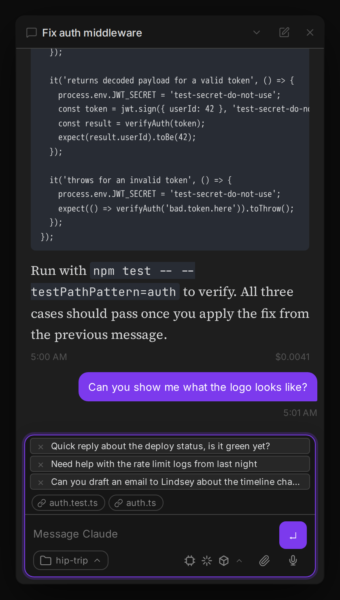
</p>

**Activity indicator.** While Claude is processing, a typed status card appears above the input area showing what's happening:

- **Active work** — a pulsing spinner with a short label (e.g. "Compacting context…" during automatic compaction, "Retrying API call…" on transient errors). The card disappears as soon as the operation completes.
- **Rate limit** — if the API returns a rate limit response, a card shows in warning or error style depending on whether the request was allowed to proceed or rejected outright.
- **Model escalation tip** — when a turn is routed to the escalation model (e.g. Fable 5 when you send `/escalate`), a brief tooltip pops up from the composer's settings indicator rather than reshuffling the layout. It fades in, holds for a moment, then fades out automatically — no interaction needed and zero layout shift. For the rest of the escalated turn, the settings popover's Model row reads "\<model\> (this turn)", so you can confirm the escalation at any point until the turn completes.

**Idle spinners pause automatically.** A thread parked at an unanswered plan/permission prompt (or otherwise wedged) stays "running" until you answer it, but its infinite spinner animations freeze after ~45s of no progress instead of compositing forever — this keeps a stuck thread from pinning the renderer's CPU. Answering the prompt resumes progress and the spinner un-freezes. A thread waiting on an ExitPlanMode plan approval also shows the calmer **Awaiting** indicator rather than the aggressive running spinner.

<p align="center">
  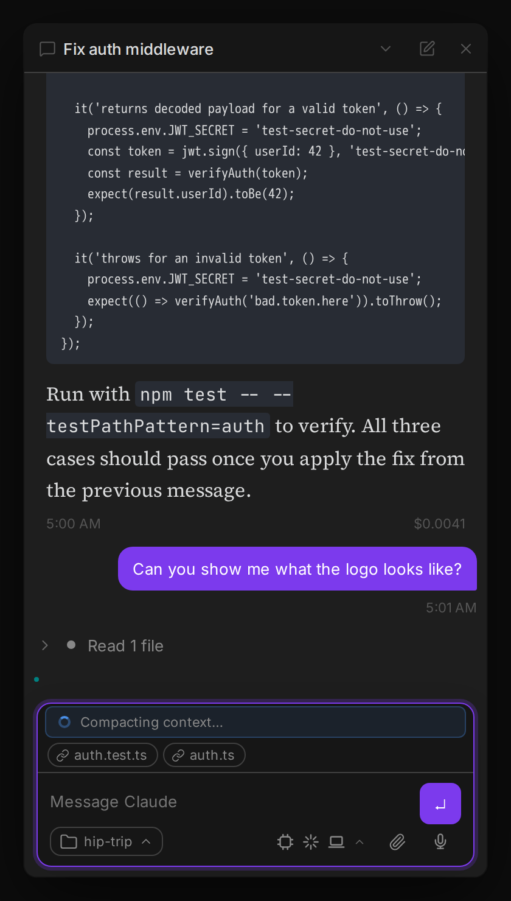
</p>

### Slash commands

Type `/` in the input box to see built-in context commands and your installed Claude Code skills. Navigate with arrow keys, Tab, or Enter.

Enabled peer plugins can also contribute commands to the thread composer and/or new-conversation composer through `extensions.registerSlashCommand`. Their commands appear immediately, use the same dropdown and command pills, and disappear when the peer disposes its registration. Host commands retain priority. A failed contributed dispatch restores the draft and attachments instead of sending the command text to the agent. `/design` is supplied by the separate **Artifacts for Agent Threads** plugin.

**Built-in commands** (handled by the plugin):

| Command | What it does |
|---|---|
| `/model fable\|opus\|sonnet\|haiku` | Set a persistent model for this thread |
| `/model default` | Reset thread model back to the global default |
| `/model` | Show the current model for this thread |
| `/goal <text>` | Set a persistent goal for this thread — injected into every turn until cleared |
| `/goal clear` | Clear the thread's goal (`/goal` alone shows the current goal) |
| `/loop <interval> <prompt>` | Send a prompt now and re-run it on an interval (e.g. `/loop 10m check CI`); replaces any loop already running on this thread |
| `/loop stop` | Stop the thread's loop (`/loop` alone shows it) |
| `/compact` | Summarize conversation history to free up context window |
| `/clear` | Clear conversation history and start a fresh session |
| `/cost` | Show token usage and cost for the current session |
| `/usage` | Show provider token totals, quota windows/resets, and account activity where available. For Claude subscription sessions the 5-hour and 7-day windows show a live utilization % pulled from the SDK's structured usage API; API-key/Bedrock/Vertex sessions show `—` because plan limits do not apply there. |
| `/context` | Show a per-category token usage breakdown for the active session (tools, system prompt, skills, MCP tools, conversation, etc.) |
| `/create-pr` | Send the configured **Create PR message** to the active agent — same action as the [git diff bar](#git-diff-bar-create-pr)'s Create PR button |
| `/create-pr --draft` | Send the configured **Create draft PR message** — same as the git diff bar's Create draft PR button |
| `/design <brief>` | Start a new design thread from the Agents List or Agent Board, or create or revise a secure static UI artifact in the current thread, and open it in Geode's ArtifactView |
| `/escalate <prompt>` | Route just this turn to the [escalation model](#model-switching) (default `/escalate`, keyword and target model configurable in Settings; only shown when escalation is enabled) |

### Design artifacts in Geode

Install and enable **Artifacts for Agent Threads** (`threads-artifacts`, formerly Design for Agent Threads) alongside Agent Threads to add `/design`, `EnterDesignMode`, previews, capture, and artifact creation. Without it, existing legacy design artifacts remain visible and their source can still be revealed, but new Design commands and tools are not registered.

Starting in v0.43.0, Design is no longer built in. Download `main.js` and `manifest.json` from the [latest threads-artifacts release](https://github.com/rbcodelabs/threads-artifacts/releases/latest) (currently [v0.9.0](https://github.com/rbcodelabs/threads-artifacts/releases/tag/v0.9.0)) into the plugin folder `.obsidian/plugins/threads-artifacts` in your vault. The folder must be named exactly `threads-artifacts`, because Geode requires the manifest id to match the folder name. If you installed the earlier release under `threads-design`, rename that folder to `threads-artifacts` by hand, replace both files with the latest release, and re-enable the plugin. Enable Agent Threads first, then Artifacts for Agent Threads. The repository is public. The `agent-threads.design` provider id, `/design`, `EnterDesignMode`, and the `.threads-design/` sidecar folder keep their names. Interactive preview and screenshot capture require Geode; Obsidian reveals the artifact source instead. Pinned comments on previews additionally need a Geode release newer than v0.30.19.

Use `/design <brief>` from the new-conversation composer to create a new design thread, or use it in an existing thread to create or revise that thread's artifact. Threads creates a zero-install static UI artifact under `.geode/artifacts/` in your vault, and the agent edits ordinary `index.html`, `styles.css`, `app.js`, and local asset files. The artifact card keeps a primary **Preview** button plus icon-only **Capture design screenshot** and **Reveal design source** buttons (hover either for its label) available after the turn and after reopening the thread. Run `/design` with no brief inside a thread to reopen its existing preview; a new-thread dispatch always requires a brief. Design dispatch does not currently accept image or text attachments.

Geode's ArtifactView previews the result with live reload, desktop/tablet/mobile viewport controls, runtime diagnostics, and PNG capture. Artifacts run in an isolated, ephemeral, Node-less guest with network, clipboard, downloads, popups, and external navigation denied. Outside Geode, Threads reveals the source instead of launching the artifact without that sandbox.

**Command pills** — when you complete a built-in command (type `/goal ` or pick one from the dropdown), it turns into a pill chip at the left of the input box. Type the arguments after it; a single Backspace at the start of the input (or clicking the pill's ×) deletes the whole command. After a command, argument autocomplete kicks in — `/model ` offers `fable|opus|sonnet|haiku|default`.

**Skills** — every skill available to the session appears below the built-in commands: your `~/.claude/skills/` library (invoked bare, e.g. `/my-skill`), skills the plugin installed into the vault (namespaced under the `vault` plugin, e.g. `/vault:my-skill`), and skills from any configured plugin source (namespaced after themselves, e.g. `/my-skill:my-skill`). The autocomplete shows the name you actually invoke, so what you pick is what resolves.

### Skills Manager

Open the **Skills Manager** from the ribbon (puzzle icon) or command palette to browse, install, and edit Claude Code skills. New views open in the left sidebar under conversation-first placement (creating it if it isn't open yet), or a main document tab under classic placement — matching where the Agents List opens; if Skills Manager is already open, it is focused without moving it or discarding edits. The list and detail panels are split by a **draggable divider** — drag it to resize, double-click to reset to the default width; your chosen width is remembered next time you open the view.

**In a narrow pane** — a sidebar, a split view, or on mobile — there isn't room for both panels side by side, so the view shows **one at a time**: the list until you pick something, then that item's detail panel with a **← back** button to return to the list. The divider is hidden in this mode, and the panel responds to its own width rather than the window's, so widening the sidebar past roughly 480px restores the two-panel layout on the spot. If you have unsaved edits, going back asks before discarding them.

<p align="center">
  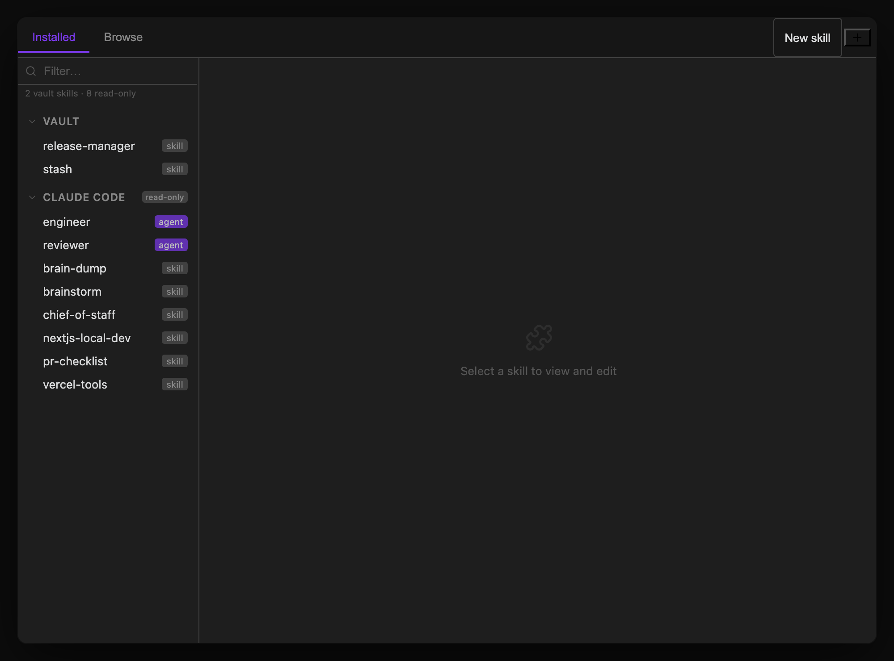
</p>

**Installed tab** — shows everything installed as a collapsible source tree. The top-right corner of the tab bar has two icon buttons (Installed tab only): **Import** (+) opens a menu with **Folder…** and **File (.skill)…**, letting you install a skill directly from a local folder or a packaged `.skill`/`.zip` archive without going through GitHub; and **Check for updates** (↻, shown once you have at least one GitHub plugin source) re-fetches staleness for all GitHub plugin sources in parallel — its icon spins while running, and a toast reports the result when it finishes (including which sources failed to check, e.g. if you're offline). An indicator dot appears on the button afterward if any plugin has updates (hover either button for its full status/tooltip). GitHub plugin sources appear as top-level nodes with a badge (`•N`) when updates are available; clicking one expands it to reveal its skills and opens a detail panel with **Update** (fast-forward, highlighted when updates are available), **Reload** (re-scan from disk), **Reinstall** (delete and re-clone for broken installs), and **Remove Source**. Two more nodes sit at the bottom. **Vault** lists the skills this plugin installed into your vault — click one to view and edit it, with **Save**, **Reload**, **Reveal in Finder**, and **Uninstall**. **Claude Code** lists everything in `~/.claude/` (skills *and* agent profiles), marked `read-only`: the plugin shows them because the Claude CLI genuinely loads them into every session, but it never writes to that directory, so those panes offer only **Reload** and **Reveal in Finder**. Edit or remove them with the `claude` CLI, or by hand.

> **Adding skill sources.** Skill sources are managed here, not in Settings. Click the **+** button in the Installed tab and choose **GitHub repo…** (clones the repo into the plugin folder) or **Local folder source…** (registers a folder you already have). Update, Reinstall and Remove live in the source's detail panel for GitHub sources, and **Remove source** in the Browse tab for local ones. **Settings → Skills** only shows how many sources are configured and a button that opens Skills Manager.

> **Where installs go.** Everything the Skills Manager installs or imports lands in `<vault>/.obsidian/plugins/claude-threads/skills/`, beside the plugin's `skill-sources/` clones — never in `~/.claude/`. That folder shares the plugin folder's fate: community-plugin *updates* leave unknown subdirectories alone, but manually uninstalling and reinstalling the plugin will delete your installed skills along with it.

Click a GitHub source's **chevron** to expand or collapse its skills while staying in the list. Click the rest of the source row to open its details. In narrow panes, this lets you browse the expanded skills without switching screens.

#### Authoring local skills

Choose **New skill** in Skills Manager, enter a lowercase identifier such as `meeting-notes`, and edit the starter `SKILL.md`. Authored packages appear under **Local skills** and live in `<vault>/Skills/<identifier>/`. Set **Settings → Skills → Local skills folder** to another vault-relative folder. Changing it does not move files. Marketplace installs, imports, and GitHub source clones retain their existing locations; nothing is migrated.

Agents can use `skills_create_local({ skillId, skillMd, files? })` and `skills_update_local({ skillId, files?, deleteFiles? })`. Each file is `{ path, encoding: "utf8" | "base64", content }`, relative to the package. Creation requires YAML frontmatter with a `name` matching the identifier and a nonempty `description`. Updates preserve omitted files and remove only explicitly listed paths; `SKILL.md` can be replaced but cannot be deleted. Paths cannot traverse outside the package or follow symlinks. Supporting files can be managed through these tools or the filesystem.

Authored skills are available in newly started Claude and Codex sessions as `/local:<identifier>`. Active sessions are not restarted. Installed Claude skills retain `/vault:<name>`. Use qualified identifiers from `skills_list_installed`, such as `local:meeting-notes`, with `skills_get` and `skills_uninstall` to distinguish same-named packages. Ambiguous removal involving an authored skill is rejected. `skills_update` continues to pull configured GitHub sources.

**Auto-update.** GitHub skill sources are fetched and fast-forwarded in the background on launch and every 6 hours (**Settings → Skills → Auto-update GitHub skill sources**, on by default). Skill sources use a built-in git client (isomorphic-git), so no `git` install is needed. Updates are fast-forward only: a clone with local commits, or a locally edited file that upstream also changed, is left alone and a warning is logged. Public repos are fetched anonymously. Private repos use Geode's GitHub connection (**Settings → GitHub**) and need the Geode GitHub App installed on the repo; the token is only ever sent to `github.com`, and only after GitHub rejects the anonymous request. Obsidian and older Geode have no connection, so private repos fail there with a hint; pinned (`ref`) sources are skipped. Updated skills apply to new threads, and a notice tells you which sources changed. Skills are instructions your agents follow, so turn this off if you source skills from repos you don't trust.

#### Declaring skill sources in config

GitHub skill sources don't have to be added through the Skills Manager UI. A vault whose `data.json` is committed to a config repo can **declare** them, and the plugin materializes each one on load:

```jsonc
"skillSources": [
  { "id": "", "name": "Agentic PM Playbook", "type": "github",
    "repoUrl": "https://github.com/owner/repo" }
]
```

`repoUrl` is the only field that matters. Both machine-specific fields are filled in for you and written back to `data.json` on first load:

- **`id`** — derived deterministically from `repoUrl` (a `gh-<hex>` digest prefix), so the same declared config resolves to the same id, and therefore the same clone directory, on every machine. Sources you add through the UI keep their random UUID.
- **`clonePath`** — computed as `<vault>/<plugin-dir>/skill-sources/<id>`, so an absolute path never has to be committed.

Three things to know about the pass:

- **Clone-if-missing only.** An existing clone is never fetched or pulled on launch — that would add network latency to every startup and swap skills out from under a running session. Updating stays explicit: the **Check for updates** button, **Update** in a source's detail panel, or the `skills_check_updates` / `skills_update` tools.
- **It cannot delay or break startup.** It runs after the workspace is laid out, is never awaited by plugin load, and shells out to `git` asynchronously. Each source is attempted independently: a private repo, an unreachable host, a rate limit, a missing `git` binary or a 60-second timeout is logged to the console and skipped, leaving every other source unaffected. A source still cloning when a thread starts is picked up by the next session.
- **It only creates what it owns.** `type: "local"` sources are left alone, as are hand-edited `clonePath`s pointing outside the managed `skill-sources/` folder.

This also repairs a source whose clone has gone missing — previously a source listed in settings with no directory on disk was silently inert, contributing no skills and no error. Use **Reinstall** in the source's detail panel to force a re-clone of one that is present but broken.

**Browse tab** — search the [skills.sh](https://skills.sh) registry. Results show the skill name, GitHub source, and install count. Click a result to see details and an **Install** button that clones the skill from GitHub into `<vault>/.obsidian/plugins/claude-threads/skills/`. Installed skills are invoked as `/vault:<name>`.

### @ file mentions

Type `@` anywhere in the input box to search vault files by name. A dropdown appears showing up to 20 matching files — navigate with arrow keys and press Tab or Enter to insert.

<p align="center">
  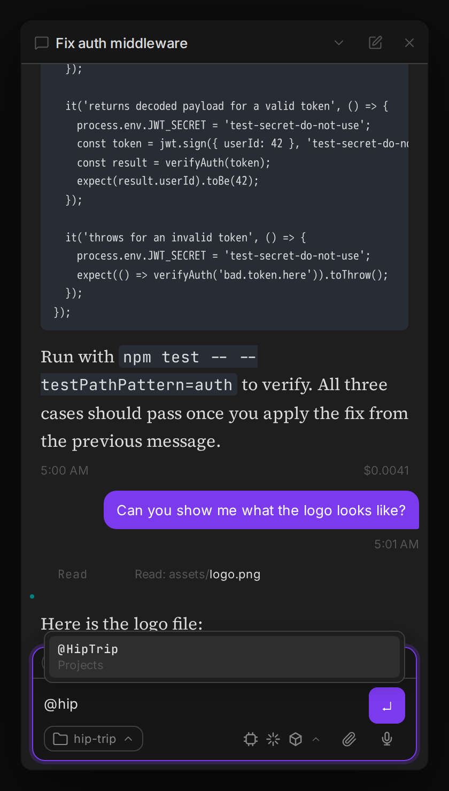
</p>

Selecting a file inserts `@[[filename]]` into your message. When you send the message, the plugin resolves each mention and appends the file's full content as context for Claude — useful for asking Claude to work with a specific note, doc, or config file without copying and pasting.

Type `@this` (no search needed) to instantly reference the currently active file in the host workspace. It resolves to the same `@[[filename]]` injection at send time.

### Chat about this document

To start from a note rather than from the composer, use **Chat about this document**. It is available from three places:

- **Right-click a note in the file explorer**
- **Right-click inside an open note** (editor context menu)
- **Command palette** → *Chat about this document* (acts on the currently open note; hidden when the active file isn't a note)

All three open a new conversation in the message panel, seeded with `@[[<note name>]] `, with the cursor after the mention — type your question and send. Because it opens a new conversation, submitting always starts a **new thread** rather than adding to an open one, and the mention resolves to the note's full content exactly like a manually typed `@` mention.

The draft is appended to, never overwritten: if you had already typed something, the mention is added to the end, and triggering the action twice on the same note won't inline it twice. The action only appears on Markdown notes, since that's what the mention resolver can read back.

### Watch a document

To have a thread notice when a note changes without polling it yourself, use **Watch this document**. It is available from the same three places as *Chat about this document*:

- **Right-click a note in the file explorer**
- **Right-click inside an open note** (editor context menu)
- **Command palette** → *Watch this document* / *Stop watching this document* (label flips depending on whether the active thread is already watching the active file)

The watch is owned by whichever thread is currently active when you trigger it — only that thread is alerted, and it stays alerted even if you switch away. If no thread is open, a notice asks you to open or start one first. When the note's content changes — from you, from another thread's edit, from a sync, from anyone — the owning thread receives an injected message referencing the file with the same `@[[filename]]` mention the composer uses, so the full content is right there in the alert. Saving a note with no actual content change (e.g. a no-op resave) does not trigger an alert, and a burst of edits to multiple watched files collapses into one batched message instead of one per file. Renaming a watched file keeps the watch attached; deleting it sends one final alert and removes the watch.

Agents can do all of this without the menu via three MCP tools — see [`watch_document`](agent-tools.md#session-tools) below. Manage active watches, see who owns each one, and unwatch from outside the file itself under **Settings → Scheduled → Watched documents**.

### Agent browser

Claude can drive a browser **inside Geode**, using the same embedded web view that powers Web Viewer tabs, instead of launching a separate Chrome. That removes the second browser process entirely — and with it the pile of orphaned Chrome instances that an external automation CLI leaves behind.

Turn it on under **Settings → Tools → Agent browser**, then reload. The toggle is disabled on hosts that can't support it (see *Limits* below).

Pages are read as an **accessibility snapshot** rather than screenshots or raw HTML — a compact list of the things a person could actually interact with:

```
- textbox "What needs doing?" [ref=e1]
- button "Submit the form" [ref=e2]
- link "Documentation" [ref=e3]
```

Claude reads that, hands back a ref, and acts on it. No coordinate guessing, no brittle CSS selectors. Hidden and disabled elements are left out, so every ref is something you could have clicked yourself.

| Tool | What it does |
|---|---|
| `browser_navigate` | Open a URL and return a snapshot |
| `browser_snapshot` | Re-read the current page |
| `browser_read_text` | Visible page prose (up to ~20,000 characters), for when the snapshot isn't enough |
| `browser_save_page` | Save the page's text or HTML to a temp file and return its path and size, for pages too large to read inline (e.g. raw JSON). Explore it with `jq`, `grep` or Read; files are deleted when the session or thread ends |
| `browser_click` / `browser_type` | Act on a ref |
| `browser_scroll` | Scroll the page (or the scrollable panel under the middle of the viewport) `up`/`down`/`left`/`right` by an optional `amount` in pixels, or scroll a ref (with its snapshot `epoch`) into view. Reports the new and maximum scroll position and whether anything moved. Moves the viewport only, so it is prompt-free like the read-only tools |
| `browser_screenshot` | PNG of the current page (with Claude's cursor and focus ring drawn in). Optional `maxWidth`; set `save` (and optionally `filename`) to also write the PNG to a temp file and get its path and size back alongside the inline image |
| `browser_status` | How many sessions are open, and the cap |
| `browser_close` | End this thread's session |
| `browser_resize` | Resize the viewport (320-1920 wide, 240-1080 tall) and return a fresh snapshot |
| `browser_console` | Buffered console output (log/info/warn/error/debug, uncaught errors, unhandled rejections) for the current page. `level` is a minimum severity; `limit` and `clear` are optional. Last 500 messages, reset on navigation |
| `browser_network` | Requests the current page made: type, method, URL, status, duration, size, failed. `filter` (URL substring), `limit`, `failedOnly`, `clear`. Last 500 entries, reset on navigation |
| `browser_eval` | **Last resort.** Evaluate a JavaScript expression in the page and get back size-capped JSON, for page state no other tool exposes. **Off by default**, and every call asks for approval; see below |

`browser_console` and `browser_network` only report what the page already did, so they are read-only and skip the permission prompt. Console text and network entries are page-authored, so they come back in the same untrusted-content block as `browser_read_text`. The console is captured by the host from the web view's `console-message` event, outside the page's own JavaScript, so a page cannot rewrite `console` to hide what it logged. The network log comes from a small script injected into the page (the web view exposes no request events to a plugin), which sets its limits: requests that fire before the page finishes parsing show up without method or error detail, status and size are absent for cross-origin resources that do not send `Timing-Allow-Origin`, WebSocket traffic is not logged, and only the top frame is covered. Request and response headers and bodies are never recorded, and credentials and sensitive-looking query values (`token`, `key`, `password`, `code`, ...) are masked in logged URLs.

**Evaluating JavaScript.** `browser_eval` is a last resort, and its tool description tells Claude so: it must not be used to find elements, scroll, click, type, read page text, or read the console or network log, because `browser_snapshot`, `browser_scroll`, `browser_click`, `browser_type`, `browser_read_text`, `browser_console` and `browser_network` do all of that without interrupting you. Use it only for page state nothing else exposes. It is registered always but refuses until you turn on **Settings → Tools → Agent browser → Allow agents to evaluate JavaScript in the browser** (`enableAgentBrowserEval`, applies immediately). Once enabled it is permissioned like `browser_click` and `browser_type`: the approval card shows the full expression, and Always Allow is available. Results, and any exception the expression throws, are returned in the untrusted-content block and capped at 20,000 characters. Navigation policy is not a bypass target: literal URLs in the expression are checked against the same scheme and private-network rules as `browser_navigate`, and a page that gets navigated somewhere blocked is stopped. A URL assembled at run time cannot be checked in advance, and a page with a strict Content-Security-Policy may reject evaluation outright.

**Watching it work.** In the chat, each browser session is **one live card** instead of a stack of tool pills: a small browser bar with the current address and status, the latest screenshot (a placeholder until the agent takes one), and a caption naming the step in progress. Other tool calls (such as Bash) made mid-session do not split it into extra cards; they appear right after the session card. A step list under it keeps every action's verb, target, outcome and duration. When the session ends the card folds into a one-line chip with a thumbnail (click to expand, click the picture to see the screenshot larger); a failure stays open and shows the error; `browser_close` mutes it. In a wide pane the card goes two-column. You can also run **Open Agent Browser** from the command palette for a sidebar pane showing live frames, the page, session age, and a stop button. It streams only while visible, and closing it never closes Claude's session.

`browser_save_page` writes a file, so unlike the read-only tools above it goes through the normal permission prompt. Files live under the system temp folder (outside your vault), are capped at 10 million characters each, and only the 20 most recent per thread are kept. `browser_screenshot` with `save` writes into the same folder under the same limits (pages and screenshots count together); the tool stays in the read-only group, so saving a screenshot does not raise a separate prompt on hosts that gate by tool name.

**Watching it work.** In the chat, each browser session is **one live card** instead of a stack of tool pills: a small browser bar with the current address and status, and a live view of the page that mirrors the Agent Browser pane (a frame about once a second while Claude is acting, every few seconds when idle, and only while the card is actually on screen), and a caption naming the step in progress. Frames carry a visible **agent cursor** where Claude last clicked or typed (with a brief ripple on a click) and a **focus ring** around the field it is typing into, so you can follow what it is doing; these marks are drawn into the page the agent is browsing but are invisible to its snapshots and never change the page's layout. When the session ends the card settles to the final screenshot. A step list under it keeps every action's verb, target, outcome and duration. When the session ends the card folds into a one-line chip with a thumbnail (click to expand, click the picture to see the screenshot larger); a failure stays open and shows the error; `browser_close` mutes it. In a wide pane the card goes two-column. You can also run **Open Agent Browser** from the command palette for a pane (opened as a main-area tab, so there's room to work in it) showing live frames, the page, session age, a stop button and **Take over**. It streams only while visible, and closing it never closes Claude's session.

**Signing in.** Some sites open a separate popup for login (Google, GitHub, SSO) — the kind of flow Claude can't complete on its own, since it never sees or drives popups. When a page tries to open one, the same chat card turns amber with **"Sign-in needed"**, a 30-second countdown, and **Take control** / **Not now** (the Agent Browser pane shows the same request as a banner). Accepting opens a second, temporary browser page: the card becomes a solid amber **"You're in control"** with the sign-in page streamed live in an amber frame, a persistent *"You're in control · Claude is waiting"* chip above the composer, and a big **Return control** button. Typing and clicking there go to that page, not to Claude's session, which is left completely untouched — and **Claude can't see that page or what you type**: the frames and keystrokes are never added to the conversation, images, saved data, logs or tool results. Click **Return control** (or just close the temporary page) when you're done; the card confirms *"Signed in · Claude resumed"*, folds back to normal and keeps a "sign in · you" step, and Claude picks up wherever the sign-in left things — reading whatever the identity provider left on the page, the same as any other page state. If the countdown lapses before you click, the card says the request expired; ask Claude to try again. Mode changes are announced to screen readers, and everything is reachable by keyboard. **Take over any page.** Not every login is a popup — Reddit's is an ordinary form. The Agent Browser pane has a **Take over** button whenever Claude has a browser open: it opens the pane in the main area and lets you click and type straight into Claude's own page (its cookies stay, so the login carries over). While you're driving, Claude is paused — any browser action it tries returns "a person has taken over" and it can't screenshot or read the page — and the page is exempt from the usual idle/age recycling. **Return control** hands the page back exactly as you left it (Claude re-reads it before continuing). Popup sign-ins also open the pane in the main area automatically. This is mouse clicks and typing only — no drag, hover, or right-click — and keyboard support covers printable characters plus the common editing/navigation keys, which is what a login or MFA form needs.

**Resource limits.** Each session is a real browser process, so they're capped (2 by default, 4 maximum), reclaimed after 5 minutes idle, recycled after 30 minutes, and closed automatically when their thread is deleted or the plugin unloads. Geode measures file-descriptor pressure, and the browser refuses to start a session when the app is running low — the specific condition under which a sandboxed page process dies on arrival.

**Safety.** Sessions use their own cookie jar, separate from your Web Viewer tabs, so you'll be logged out of most sites. Page text is handed to Claude wrapped as untrusted data rather than as instructions. Typing a stored secret into a page is refused outright. `file:`, `javascript:` and cloud metadata addresses are blocked; private network addresses are behind an opt-in.

**Limits.** Geode desktop only — it needs the process diagnostics Obsidian doesn't expose, and mobile has no embedded web view at all. Top frame only, no iframes, file uploads, or multiple tabs. It also can't drive Electron desktop apps, evade bot detection, or use cloud browsers; the `agent-browser` CLI skill still covers those.

### Model switching

`/model` sets the model for all subsequent turns in a thread:

```
/model fable    → uses Claude Fable 5 for every turn in this thread
/model opus     → uses Claude Opus for every turn in this thread
/model sonnet   → switches to Sonnet
/model haiku    → switches to Haiku
/model default  → resets to the plugin's Default model setting (or the CLI default)
```

A **Default model** dropdown in settings picks the model for threads that have no `/model` override. Family aliases (Fable / Opus / Sonnet / Haiku "latest") are always listed first; pinned model IDs are sourced from the SDK's `capabilities_discovered` event, which fires the first time a thread starts in the current host session. Before any thread has run, the dropdown falls back to a hardcoded list of current models — start a thread and reopen Settings to see the full CLI-sourced list, so no plugin update is needed when Anthropic adds a new model. The Escalation model dropdown is populated the same way.

You can also switch models without typing: open the **settings indicator** (the model, harness and location glyphs) in the conversation footer and pick the **Model** row, which names the model currently in effect. Choosing it opens the Default list followed by each family alias labelled with the version it currently resolves to (for example **Opus 5.5 (latest)**, **Sonnet 5.5 (latest)**). The **(latest)** tag appears only when the alias resolves to the newest version known for that family; if the provider maps an alias to an older model (for example Sonnet resolving to 4.5 on Amazon Bedrock while 5.5 exists), the row reads **Sonnet 4.5** with no tag. The menu also lists any pinned model IDs the SDK reports so an older version can be selected explicitly. Before a session has run, the labels use built-in current versions. It stays in sync with the `/model` command. Once the thread has replied, the menu also shows the exact model the provider reports for it: the Model row reads, for example, **Default · Opus 5.5**, and the top of the model list shows **Running: Opus 5.5 (us.anthropic.claude-opus-5-5)**, so you can see what **Default** or a "latest" alias actually resolves to, including Bedrock and Vertex model IDs. If your installed `claude` CLI is stale (for example an old Homebrew install that predates a model), the model list opens with a one-line notice naming the upgrade command (such as `brew upgrade claude-code`); the model list comes from the CLI, so upgrading it is what adds new models.

The active model is shown as a badge in the thread info bar. You can also use `/escalate` as a one-turn override — it routes just that message to the Escalation model chosen in settings (Fable 5, Opus, Sonnet, or Haiku), then the thread model resumes. Both the keyword and the target model are configurable, and (when escalation is enabled) the current keyword shows up alongside `/model`, `/goal`, etc. in the `/` autocomplete popup so it's discoverable without reading the docs — renaming the keyword or toggling escalation off in Settings updates the popup immediately. While an escalated turn is running, the settings popover's Model row names the escalated model and marks it "(this turn)", so you always have visible confirmation that the escalation took effect. The label reverts automatically when the turn finishes.

When Claude refuses a response, Agent Threads shows the SDK-provided notice if Claude retries on a fallback model, and a clear notice when no fallback is available.

### Goals and loops

**Goals** — `/goal <text>` pins a persistent goal on a thread. You can also
right-click your latest text message in the main conversation and choose
**Set as goal**, which is useful when you forgot the `/goal` prefix. Older,
blank, and image-only messages do not offer the action.

Setting a goal does two things:

1. Claude immediately starts working toward it — no separate prompt needed.
2. The goal is injected into the authoritative system/developer context on
   **every subsequent turn**, so it survives context compaction, topic drift,
   and multi-day threads. If the thread is already active, its current work,
   permission request, or background task is allowed to settle before the
   session safely refreshes and starts the latest goal.

`/goal` alone shows the current goal; `/goal clear` (or `off`/`done`) removes it
and refreshes the session context without sending another kickoff.

**Loops** — `/loop <interval> <prompt>` re-sends a prompt to the thread on a schedule:

```
/loop 30s poll the deploy status     → every 30 seconds
/loop 5m check the build             → every 5 minutes
/loop 1h summarize new emails        → every hour
/loop 10 check CI                    → bare numbers mean minutes
```

Like `/goal`, starting a loop sends the prompt immediately — you don't wait for the
first interval to elapse. Intervals below 30 seconds are clamped to 30s. Loops run on
the plugin's built-in scheduler, so they **persist across plugin reloads and host app
restarts**. If a loop tick arrives before the thread's previous turn has finished, it's
retried shortly after rather than piling up as a queued duplicate. A thread can only
have one active loop at a time — starting a new `/loop` replaces whichever loop was
already running there. `/loop` alone lists the thread's loop with its next run time;
`/loop stop` (or `off`/`cancel`/`clear`) stops it. While a loop is active, a compact
scheduled-activity pill in the composer footer shows the interval. Click the pill
to see its next run and prompt, then use the row's **Stop** control. One-time
`ScheduleWakeup` entries appear in the same popover as distinct wakeup rows with
their own **Cancel** controls; when both are present the pill summarizes the next
item and adds a count (for example, `Resumes in 4m · +1`).

### Dispatching from the quick switcher

In Geode, type a prompt into the global quick switcher (Cmd+O) and choose **Dispatch new conversation: "<your text>"** to start a new thread from it (default project and working directory) and open it. This relies on Geode's plugin quick-switcher API; in Obsidian the row is simply not shown.

### Dispatching with commands

`/model`, `/goal`, and `/loop` also work as prefixes in the new-conversation composer (**New thread**), applying to the newly created thread:

- `/model opus fix the login bug` — creates the new thread with Opus set as its model and dispatches just the prompt
- `/goal ship the v1 login flow` — creates the thread with that persistent goal and immediately starts working toward it (same kickoff as `/goal` inside a thread)
- `/loop 10m check CI status` — creates the thread, sends the prompt now, and re-runs it every 10 minutes (stop it later with `/loop stop` inside the thread)

A command with bad or missing arguments shows a notice and keeps your draft instead of creating a thread. The thread-management variants (`/goal clear`, `/loop stop`) only work inside an existing thread.

`/escalate <prompt>` (when escalation is enabled) also appears in the new-conversation composer autocomplete — it creates the new thread and routes its first turn to the escalation model, same as using it mid-thread. A bare `/escalate` with no prompt shows a usage notice instead of dispatching.

### Context compaction

When the context window fills up, Claude compacts the conversation automatically. You can also trigger it manually with `/compact`. Either way, a divider appears in the conversation showing when compaction happened and how many tokens were in context beforehand. Compaction markers are persisted and survive plugin reloads.

### Agents List

Open the **Agents List** from the ribbon or command palette to see all threads at a glance. Its native host header shows the filtered thread count and standard icon actions for Search and Group; search opens in a separate content row so the title bar stays stable. The native Group menu has independent **Project** and **Status** toggles, supporting Project-only, Status-only, or the default Project + Status hierarchy. At least one grouping remains enabled, and the choice is saved for the next session. In Status-only mode, each row shows its resolved Project as context. The list has no dispatch box: **New thread** opens the message panel in new-conversation mode, whose **Project** chip opens the searchable project picker; choose **No Project** to use the global default working directory.

Adaptive two-line rows use **Working**, **Waiting**, **New**, **Reviewed**, **Failed**, and **Ready** status classification. The primary line shows status, title, orchestrator indicator when applicable, and recency; activity, repository/Project context, and agent count share a truncation-safe secondary line. Permission, question, plan, waiting, and AWS reauthentication states expand into dedicated action rows when your attention is required. Child-agent activity is summarized by one accessible agent-count control; it turns green only while at least one child agent is starting, working, or waiting, and otherwise uses the same faint secondary treatment as recency. Click it to open the team picker without losing your current agent selection.

In new-conversation mode (**New thread**), the send button shows the harness that will run the new thread: **Claude**, **Codex**, or **OpenCode**. Click normally to start with the shown harness. Right-click, press and hold, or use `Shift+F10` while the button is focused to open the harness menu (which also holds the **Run on** choices for Claude); choosing an option changes the button without sending. **Settings → Agent harness** supplies the initial default only—the choice does not change the global setting. Existing idle threads can be switched separately from the composer settings popover.

**Live activity (running threads):** While a thread is actively processing, the dashboard shows a live one-line summary of the current tool call or step — so you can see "Reading src/components/Header.tsx" or "Running npm test" without switching to that tab.

**Auto-generated summaries (idle threads):** Once per completed turn, the summarizer runs in a lightweight background process (a separate Claude Code instance using a small model, with no tools or MCP servers loaded) and writes a multi-sentence recap of what that thread worked on. It runs for background and scheduled threads too, so the dashboard stays current for agents you aren't watching. This summary is shown in the dashboard row so you can re-orient yourself to any thread at a glance — what it accomplished, what files it touched, what's left to do.

This combination means you can dispatch several threads in parallel, switch to other work, then return to the dashboard to understand the state of every agent without reading through each conversation.

You can also send messages to any thread directly from the dashboard without switching tabs.

**Background tasks stay "Working."** A thread that spawns a background subagent (`Agent(..., run_in_background: true)`) or runs the `Workflow` tool can have its own turn finish — and its activity line stop updating — before that spawned work actually completes server-side. Rather than misclassifying the thread as New/Reviewed/Ready the moment the outer turn ends, the Agents List (and the [Agent Board](usage.md#agent-board)) keeps it under **Working** until the background task or workflow reports back.

If a background task finishes while its thread is actively streaming, the running turn's live task pill shows the result inline. If it finishes after the thread has gone idle, a ✓/✗ summary is appended directly into that thread's conversation as a subtle notice row (aligned with the tool rows above it), instead of a transient top-right toast — so it's still there if you open the thread later or scroll back, rather than something you had to catch in the moment.

**Scheduled Jobs.** An hourly (or more frequent) recurring cron task (see `CronCreate` / `ScheduleWakeup` below) can produce dozens of quiet threads a day, burying the manually-created ones you actually need to triage. When a run created by the scheduler is unreviewed, reviewed, or empty — never one that's running, awaiting a permission/question, or errored — it's pulled out of its normal group into a **Scheduled Jobs** section at the bottom of the dashboard, one collapsed row per job showing its name, run count, and the latest run's time. Click a row to expand it into the individual runs. Disable via **Settings → Features → Stack scheduled job threads**.

**Archive from the list (right-click).** Right-click any thread row — in the Agents List or on an [Agent Board](usage.md#agent-board) card — for an **Archive thread** action, so you don't have to open a thread just to close it. Archiving writes the thread to its vault note and removes it from the live list, exactly like the `×` on a thread tab; a run with no messages is dropped without leaving an empty note behind.

Right-clicking a **Scheduled Jobs** rollup row (or an Agent Board stack card's header) archives the whole rollup at once — **Archive these N runs**. Because one job's runs can be split across several groups (New, Reviewed, Ready) and Projects, a second item, **Archive all M runs of this job**, appears whenever the job has runs the rollup you clicked isn't showing. That turns "clear 14 runs of last night's cron job" into one action instead of fourteen.

You are asked to confirm only when there is something to lose, and never more than once per action: archiving a thread that is still running (it stops the session), archiving a Portfolio or Project Orchestrator, or archiving more than one run at a time. A combination — say, a bulk archive that includes a running orchestrator — still asks exactly once, in a single dialog listing every reason. Archiving a single idle thread happens immediately. Any pending `ScheduleWakeup` on an archived thread is cancelled, so it can't come back to life afterwards. The last remaining thread can't be archived. This is a desktop-only interaction for now — Obsidian Mobile does not fire a right-click gesture.

### Inline workflow progress

When a thread runs the `Workflow` tool (multi-agent orchestration), a live progress block appears inline in the conversation — pinned above the streaming output — showing:

- **Workflow name** and **current phase** (updates as the workflow transitions between phases)
- **Per-agent rows** — each spawned sub-agent gets a row with a dot (pulsing while running, filled when done, ✗ on failure) and its task description. Rows appear as agents are launched and update in place as they complete; they don't disappear, so you can see the full run at a glance even before the workflow finishes.
- **Done / Failed badge** — when the workflow completes, the block locks into a final state with a "Done" or "Failed" annotation.

<p align="center">
  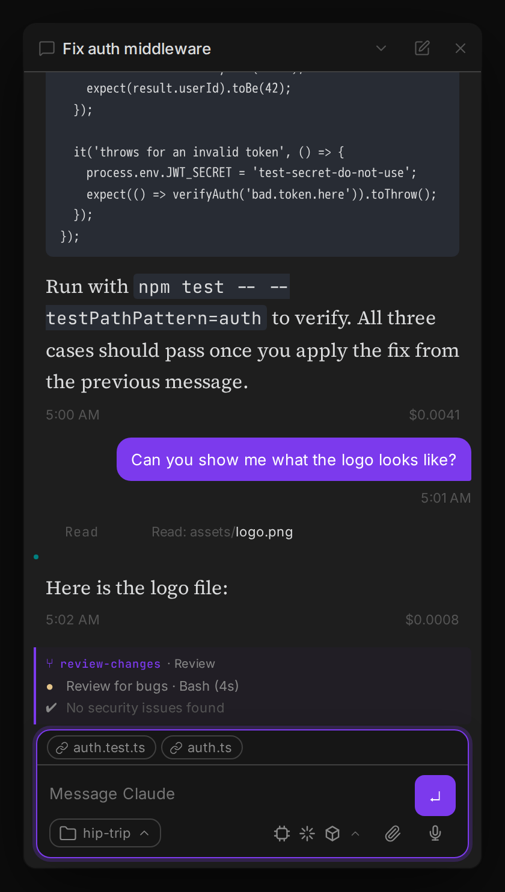
</p>

The block is rendered entirely from the SDK event stream (no extra API calls), so it appears immediately when the first sub-agent starts and has zero overhead for threads that don't use workflows.

<a id="kanban-board"></a>

### Agent Board

Open the **Agent Board** from its **kanban** icon in the left ribbon, or **Open Agent Board** in the command palette. Each thread is a card, bucketed into a column for its agent state: **Working** (also covers a thread whose own turn has ended but a background subagent or `Workflow` task it spawned hasn't reported back yet — see [Agents List](#agents-list)), **Awaiting** (permission), **Waiting** (a `ScheduleWakeup` is pending — shows a live countdown, e.g. "Resumes in 4m — check CI status"), **New** (unreviewed), **Done**, **Failed**, and **Ready** (empty). Columns are sorted most-recently-active first. The board has a **New thread** button in its header that opens the message panel in new-conversation mode; the board itself has no dispatch box.

#### Ask the orchestrator

The floating pill at the bottom of the board leads with an **Ask the orchestrator…** field, an orb (its ring spins while any thread is running) and a needs-you dot (orange when something awaits you). The old "N running · N total" header count now lives in the dot's tooltip (**2 running · 14 total · 2 need you**), in a line under the sheet title, and, on narrow boards, as a number on the dot.

- **Ask field and keys.** Press **Cmd+J** (Ctrl+J on Windows/Linux) while the Agent Board is the active view to focus the field (the key falls through untouched when it is not). The shortcut is a normal command, **Ask the portfolio orchestrator**: rebind or clear it under **Settings → Hotkeys** (Cmd+J may not fire while a modal is open). **Enter** sends, **Shift+Enter** adds a newline, **Esc** closes the sheet (or leaves the field). **ArrowUp** in an empty field (or with the caret at the very start of a one-line draft) recalls your previous message, repeated ArrowUp goes further back (the last 20, consecutive duplicates dropped), **ArrowDown** goes forward and ends on the draft you were typing. Right after a recall a one-line message keeps walking; once you move the caret inside a recalled message, only the very start (Up) or very end (Down) continues, so a long wrapped paragraph keeps normal caret movement. Nothing is recalled while an IME composition is in progress or a send is pending. The recall history keeps the last 20 messages you sent in memory only (including anything secret you typed) until you close the app or the board is re-mounted, and ArrowUp can put one of them back into the field.
- **Drafts are in memory only.** What you type survives closing and reopening the sheet, errors/offline/working states, the narrow/wide switch, a board refresh and re-opening the board in the same session. It is never written to disk or to your settings, because a draft can contain a secret; it is gone when the app quits, and it belongs to the current orchestrator thread (a different orchestrator never sees it). Boards of the same window share it, so a message sent from one board is not resurrected by another. Drafts are capped at 4,000 characters. A message that fails to send is put back in the field.
- **The reply sheet.** **Enter** sends your message to the Portfolio Orchestrator and opens the sheet above the pill (it stays open when you click the board). It shows the conversation (replies render as markdown; `[[thread:…]]` links open that thread), the orchestrator's current activity while it works, and **Stop** in place of Send to interrupt the turn. A message you send while it is working is picked up by the turn in progress and marked **Sent, will be picked up**; anything the manager is holding back (for example while a plan awaits your decision) is listed under **Waiting to send** with a remove button. Plans, questions, images, visualizations and tool detail show an **Open full thread ↗** chip instead. With the sheet closed, a new reply shows a one-line **unread peek** above the pill (about 8 seconds) and keeps the dot lit until you open the sheet; with an empty conversation, focusing the field offers suggested prompts. The sheet is never opened automatically.
- **Thread links.** Hover (or keyboard-focus) a thread link in a reply and its card on the board is highlighted and scrolled into view (instantly, with no flash, when your system asks for reduced motion); click opens the thread and the sheet stays open.
- **Needs-you tray.** A **Needs you (N)** tray above the composer lists every thread waiting on you, including the orchestrator's own, collapsing to **Show N more** beyond three. A **permission request** shows the same Deny / Allow / Always buttons as its board card, and resolving it in the sheet or on the board resolves both. Allow and Always are offered inline only when the request is small enough to be read in full: a single field (a command, a path, a URL) that is not cut and has no line breaks. A request with several fields (for example a command plus `dangerouslyDisableSandbox`), a long or multi-line detail keeps only **Deny** and a **Review in thread** button, so nothing is approved blind. A **question** or **plan** shows a single **Answer…** / **Review plan…** button that opens the thread (they are never answered inline), and the sheet does not repeat the orchestrator's own plan or question as a separate notice (it can still show one when the tray is expanded and that card is past the third). The conversation gives way before the tray does: the tray keeps its heading and first card with their buttons whenever the sheet has the room, and the composer always stays visible. In portrait with the keyboard open the first card keeps its buttons. When the sheet is too short for the whole card (a landscape phone, or a very small screen, with the keyboard open) the tray switches to a compact form: the title, the tool name and only **Deny** and **Review in thread** (Allow and Always are hidden together with the command they would approve, so nothing is approved blind; they come back when there is room again), scrolling inside the room that is left. When there is not even room for that, the tray collapses to a one-row **Review** hand-off to the first thread (or disappears; the dot and the header count still show who needs you). The transcript can shrink to nothing, the composer stays visible, and the header's close button stays reachable. In landscape with the keyboard open the first card's actions may need a scroll inside the tray. With even less room (under about 96px above the keyboard) the sheet shows only its header and composer, and when those do not fit either it waits, hidden, until the keyboard goes; it never starts above the top of the screen. Keyboard focus never falls to the page when the tray changes form. Every click is checked against the request that is pending now, so a stale card cannot approve the next one.
- **States.** With no orchestrator yet the field becomes a **Set up…** button. An errored orchestrator shows its reason (with **Open thread**), a disconnected one shows "daemon disconnected" (with **Reconnect**). Screen readers hear a short announcement when the orchestrator errors, goes offline or recovers (not on every refresh).
- **Narrow boards and phones.** Under 640px the pill collapses to the orb plus **New thread**, the sheet becomes a bottom sheet with 44px targets that respects the safe area and lifts above the on-screen keyboard (on a landscape phone the whole pill lifts), and the dot carries the needs-you count as a number.

A card's child-agent count uses the same activity treatment as the Agents List: green while any child is active, faint once all runs are terminal.

Cards support the same right-click **Archive** action as Agents List rows, including the bulk archive for scheduled-job stack cards — right-click the stack card's header row. See [Agents List](#agents-list) for the full behavior.

**Task list on cards.** When a thread has an active Claude `TodoWrite` / `TaskCreate` checklist or Codex `update_plan` checklist, its Agent Board card shows a compact task list: up to 5 items with status icons (✔ completed, ■ in-progress, ○ pending), a "X / Y done" progress line, and "+N more" when there are additional tasks. The list updates live as the agent ticks items off.

<p align="center">
  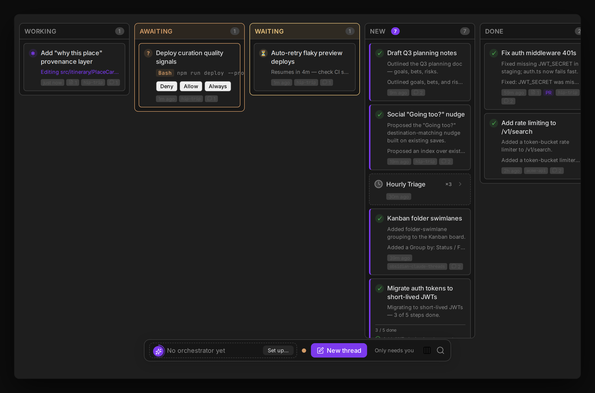
</p>

**Auto-collapse side panels.** Set **Settings → Features → Agent Board → Auto-collapse side panel** to `Left sidebar`, `Right sidebar`, or `Both sidebars` to automatically collapse the host's sidebar panel(s) when the Agent Board tab opens, giving the board more horizontal room. Only the panel(s) the Agent Board view collapsed are restored when you close the tab, so it won't fight a panel you collapsed or expanded manually. Defaults to `None` (opt-in).

**Group by folder, project or gallery.** The group-by toggle in the board header (the icon next to search) cycles through four layouts: **status columns** (the default), **folder swimlanes**, **project columns**, and **Gallery**. Each click advances to the next (status, folder, project, gallery, then back to status); the choice persists across reloads, and an unrecognised stored value falls back to status columns.

- **Folder swimlanes** — one horizontal lane per app/project, so you can see every conversation for a given codebase together. Each lane is keyed by the thread's assigned **Project**. When no Project is assigned, a thread whose repository root matches a configured Project's effective cwd joins that Project; otherwise it falls back to a working-directory label (git repo name), and an **Unassigned** lane catches threads with no folder. For a thread whose cwd is a temporary `EnterWorktree` worktree, the repo name is remembered from when the worktree was created, so it still groups correctly under the origin repo even after that worktree directory is later deleted. Inside each lane the cards are still grouped into the same status columns (empty columns are hidden to keep lanes compact). Lanes are ordered alphabetically (case-insensitive), with Unassigned pinned last.
- **Project columns** — one vertical column per app/project (same project resolution as folder swimlanes, alphabetical with Unassigned last), with each column's cards grouped under status **section headers** — Working, Waiting, New, Reviewed, Failed, Ready — matching the Agents List sidebar's grouping. Awaiting-permission threads fold into **Working**, and empty sections are omitted. This gives a compact, scannable per-project view where each column reads top-to-bottom like a mini dashboard. Each column is a fixed 300px wide; when there are more columns than fit, the board scrolls horizontally, and each column scrolls vertically on its own. With a mouse, the wheel scrolls a column while it can still scroll in that direction and otherwise moves the board sideways (Shift+wheel and trackpad swipes also work).
- **Gallery** (desktop / Geode only) — one larger card per thread, built around what the agent actually produced. Each card shows a 16:10 **hero image** (the thread's newest visual), a source badge (**Browser** for an image from a `browser_screenshot` call, **Image** for any other tool-result image) and its age, a **filmstrip** of up to 3 thumbnails (4 when the board is one column wide, 5 on a featured card) whose last slot reads **+N** when there are more, **previous / next** arrows, and an "n / m" counter. Click a thumbnail, use the arrows, or focus the hero and press <kbd>←</kbd> / <kbd>→</kbd> to step through the thread's images (newest 50 per thread; nothing is deleted). Threads that need you (a pending permission, question, decision or proposed reply) become large **featured** cards at the top with the same inline controls as the **Needs you** lane (Deny / Allow / Always, answer forms, Approve & Send); a third or later Needs-you thread shows a **Needs you** chip and opens on click. Everything else follows in a wrapping grid sorted by recent activity, collapsing to a single column on a narrow board. The search box and **Only needs you** filter apply as in the other layouts.
  - **Which threads show images.** Only images returned by tool results (screenshots, `Read` on a picture, and so on). Images you attached yourself, the in-app browser's live frame, and anything from a **private** thread are never shown. Codex, OpenCode and Replay threads do not produce tool-result images, so they, brand-new threads and threads whose images were never saved get a same-size **text placeholder card** (last message excerpt) instead of being hidden. An image whose file has gone missing shows "Image unavailable" and the counter still advances.
  - **Thumbnails and memory.** When an image is saved, a 160 px WebP `…thumb.webp` sidecar is written next to it (same `attachments/<thread>/` folder, removed with the thread), so the filmstrip does not decode full-size screenshots. Older images get theirs lazily the first time their card scrolls into view (two at a time); if a thumbnail can't be made the full image is used. Images are only loaded for cards near the viewport and released when they scroll far away.
  - **Live updates.** A new message or screenshot refreshes just that thread's card (debounced), without rebuilding the board. Mobile and relay clients do not receive tool-result images, so Gallery is not available there.

<p align="center">
  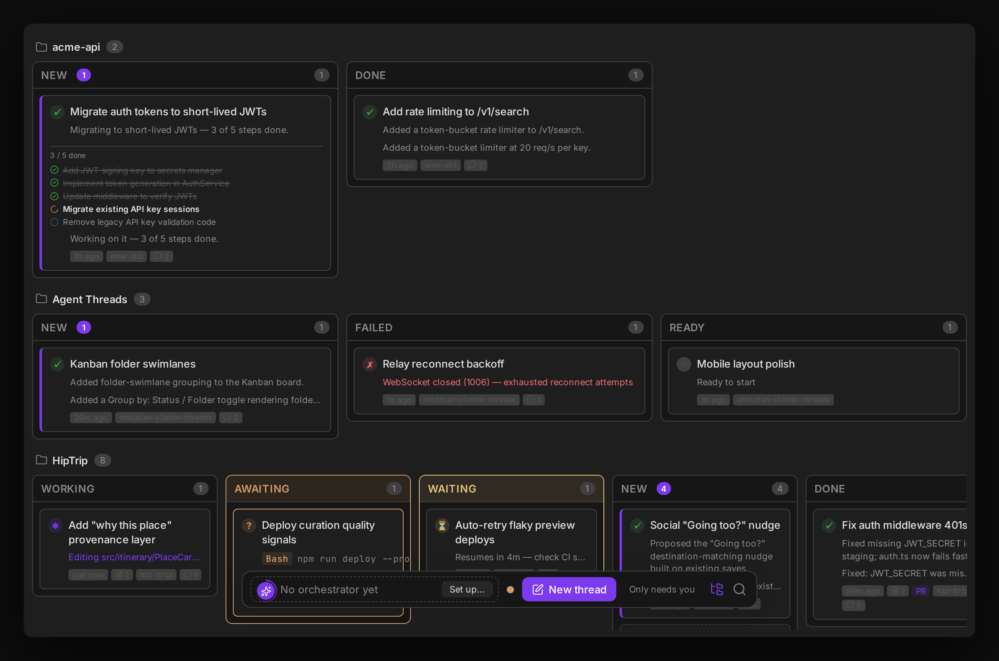
</p>

**Stacked scheduled-job threads.** Repeat runs of the same cron job pile up fast — an hourly triage job produces ~24 cards a day, crowding out the threads you started yourself. In the quiet columns only (**New**, **Done**/**Reviewed**, **Ready** — a run that's Working, Awaiting, Waiting, or Failed always stays its own card), runs that share a scheduled job collapse into a single dashed-border rollup card: job name, a "×N" run count, and the latest run's time. Click the card to expand it into the individual run cards, indented beneath. This applies in status-column, folder-swimlane, and project-column mode. Disable via **Settings → Features → Stack scheduled job threads**.

### Push-to-talk voice input

Hold the configured push-to-talk key (default: none — set it in Settings → Push to Talk Hotkey) and speak. The microphone activates while you hold the key; releasing it stops recording and transcribes your speech using the Claude Code STT pipeline. The transcript populates the input box so you can review and edit before sending. The floating input panel highlights while recording so you always know the mic is live.

### Permissions

When Claude or Codex needs to write a file or run a command, a permission card appears inline in the conversation asking you to **Allow**, **Deny**, or **Always Allow**. Always Allow adds the tool to a per-vault allowlist so you're never asked again for that tool. You can also resolve permissions directly from the Agents List without switching threads. The default behavior can be changed globally in **Settings → Tools → Permission Mode**, or **per-thread** via the **Permissions** row in the thread footer's menu — a thread-level override takes precedence over the global setting and is useful when you want plan mode for one specific task without affecting other threads:

| Mode | Behavior |
|---|---|
| `default` | Use the Claude CLI default (prompts for most tool calls) |
| `acceptEdits` | Automatically accept file edits; prompt for commands and other tools |
| `bypassPermissions` | Skip all permission prompts — Claude executes everything without asking |
| `plan` | The selected harness proposes a written plan before taking any action; you approve, edit, or reject it before it proceeds (see [Plan Mode](#plan-mode) below) |
| `dontAsk` | Suppress all interactive permission dialogs; Claude proceeds without confirmation. Intended for scheduled/background sessions that run unattended |
| `auto` | Claude autonomously decides when to prompt vs. proceed based on action risk |

> **Private chats:** run the **New private chat (not saved)** command to start a thread that is never written to disk: not to `data.json`, the vault note (including on archive), the raw JSONL log, or attachment files, and the SDK session is not persisted. It shows a *private* badge, can't be switched back to a normal thread, and is gone after a reload or archive. Other threads can still read it through the `threads_*` MCP tools while it is open.

> **Note for scheduled sessions:** threads created by the built-in scheduler automatically use `dontAsk` so cron jobs never stall waiting for a permission dialog that nobody is watching. They also inherit any external MCP servers configured under Settings → MCP (Compass, Helio, or any other user-configured HTTP/SSE/stdio server) alongside the plugin's built-in tools, so scheduled agents have the same tool surface as an interactive thread — `${VAR_NAME}` placeholders in those configs are resolved from environment variables and keychain-stored secrets. Such threads also carry the originating scheduled item's id and name (`scheduledItemId`/`scheduledItemName`), captured once at creation time and surfaced as a "Scheduled: `<name>`" footer pill and in the `threads_get_current`/`threads_list` tool output. If a scheduled run has nothing to report, its prompt may tell it to call `threads_archive` with its own thread ID. The tool acknowledges with `deferred: true`, then saves and archives the thread only after the run has fully settled; interactive threads still cannot archive themselves.

> **Active-hours windows:** a scheduled item can be scoped to a local time-of-day window so it only fires during, say, business hours. Pass `activeHoursStart`/`activeHoursEnd` (24h `HH:MM`) to `CronCreate`, or set/clear them later with `CronUpdate` (`activeHoursStart`/`activeHoursEnd`/`clearActiveHours`). When a cycle comes due outside the window it's skipped **without opening a thread at all** — the scheduler just jumps to the next window-open time — so an every-6h job scoped to `07:00`–`22:00` never wastes an overnight run. Overnight windows (start after end, e.g. `22:00`–`06:00`) wrap past midnight. **Settings → Scheduled** shows the window inline, e.g. *"Every 6 hour(s) (07:00-22:00 only)"*. This replaces baking a `date`-based business-hours check into the prompt itself, which used to burn a whole thread each time it fired just to check the clock and bail.

> **Gate commands:** a scheduled item can carry a deterministic **gate** — a shell command that runs *before* each cycle spawns a thread, so cycles with "nothing to do" are skipped without burning an agent turn. Pass `gateCommand` to `CronCreate` (with optional `gateTimeoutSeconds`, default 30 and capped at 120, and `gateFailOpen`, default `true`), or set/clear it later with `CronUpdate` (`gateCommand`/`gateTimeoutSeconds`/`gateFailOpen`/`clearGate`). **Exit `0` fires the agent; exit `1` deliberately skips an empty queue; reserved exit `75` reports that the gate could not determine whether work exists and honors `gateFailOpen`.** Other clean non-zero exits retain the existing deliberate-skip behavior. A skipped cycle creates no thread, message, or LLM call, while the schedule still advances normally. On a fire, the gate's stdout is fed into the prompt: it replaces a `{{gateOutput}}` placeholder if the prompt has one, otherwise it's appended as a `Gate output:` block (truncated to ~8 KB), so the agent doesn't have to re-derive what the check already found. The gate runs in the item's `cwd` with an ephemeral environment containing the item's Project-scoped keychain secrets (plus any global ones — see [Projects](#projects)), `CRON_LAST_RUN_MS` (epoch ms of the previous run, a natural "since last check" cursor), `CRON_ITEM_ID`, and `CRON_ITEM_NAME`; secret values are never written into schedule data. If the gate can't be evaluated — exit `75`, timeout, or spawn failure such as command-not-found — the item **fails open and fires anyway** by default (set `gateFailOpen: false` to fail closed and skip instead), so a broken check never silently blackholes a real cron. Failed-evaluation diagnostics are stripped of control sequences, redacted against keychain values, bounded to 4 KiB, and retained in run history for troubleshooting. Gates run on desktop only (they're inert on mobile, where a configured gate simply fires). **Settings → Scheduled** flags gated items inline, e.g. *"Every 5 minute(s) · gated"*. Example: `gateCommand: "test -s ~/inbox/pending.txt"` with a prompt of `Process the pending items:\n{{gateOutput}}` fires only when that file is non-empty. Because the gate is an arbitrary command run unattended, it carries the same trust profile as the existing `statusLineCommand` setting: it's authored by the same user who controls the vault.

> **Overlapping runs are skipped automatically:** a recurring job that spawns a fresh thread each cycle will **never stack a second run on top of one that is still working**. When a cycle comes due and the thread from that item's previous run is still mid-turn, the scheduler drops that cycle — no thread, no message, no LLM call — records it in run history as **Skipped (still running)**, and leaves the item on its normal cadence so the next cycle fires as usual once the run finishes. This needs no configuration: a gate command is *not* the tool for guarding concurrency (a gate answers "is there work?", not "am I already doing it?"), and an every-15-minutes job whose runs take an hour used to spawn several agents into the same working directory at once, each editing the same files. The guard deliberately **fails open** — if the previous thread has been archived, deleted, or otherwise has no live session, the item fires normally rather than wedging forever. Thread **loops** (items with a `targetThreadId`) behave differently and are unchanged: because their point is to deliver each tick into one specific thread, a busy target makes them *defer* briefly and retry rather than drop the tick.

> **Scheduled work manager:** **Settings → Scheduled** gives every recurring job, thread loop, and one-shot wakeup exactly one row, grouped by type. Each row stays compact by default with its status, cadence, next occurrence, Project, and effective execution target; enabled work is sorted by next occurrence and paused work stays last. Expand a row to inspect its prompt, working directory, active hours, gate, execution details, and recent outcomes, or to pause/resume, delete, and **Open last run**. Gated work says **Next check** because a successful evaluation is not guaranteed to spawn a thread; overdue work says **Overdue — catching up**. Use **Create with Claude** to open a normal thread that helps define and create a schedule conversationally.

### Plan Mode

Set **Permission Mode → `plan`** globally in settings, or use the **Permissions** row in the thread footer's menu to set it for a single thread, to enable Plan Mode. In this mode Claude or Codex reads, researches, and thinks — but doesn't write files or run commands — until it has produced a written plan and you've approved it. Codex can also invoke its built-in `EnterPlanMode` control when it recognizes that a task needs investigation first; Agent Threads finishes the current handoff, switches Codex to a read-only Plan turn at the safe turn boundary, and shows the same approval card.

**The flow:**

1. You send a message as normal.
2. A **"Planning…"** visual state appears in the thread while the agent gathers context.
3. When the agent finishes its plan, an inline card replaces the spinner, showing the full proposed plan text.
4. You pick one of three actions on the card:
   - **Approve** — the agent returns to its normal permission mode and executes the plan immediately.
   - **Edit** — the plan text becomes editable in-place; submitting the edited version sends it back as the confirmed plan before execution.
   - **Reject** — opens an inline feedback field while keeping the proposed plan visible for reference. Add an optional reason and choose **Reject plan** (or press <kbd>Cmd</kbd>/<kbd>Ctrl</kbd>+<kbd>Enter</kbd>) to send it as the next visible Plan-mode message; press <kbd>Escape</kbd> or choose **Cancel** to return to the original card. An empty reason keeps the existing generic revision prompt. In every case the agent remains in Plan mode and no edits are made.

Plan Mode is useful for risky or large-scale tasks where you want to review the approach before any files are touched.

### MCP Elicitation

Some MCP servers need a credential or a form filled before they can proceed — for example, an OAuth flow or a confirmation dialog. When this happens, Agent Threads renders an elicitation card inline in the conversation rather than silently failing.

- **URL auth card** — displays a clickable link for the OAuth URL. Click it to open the auth page in the host's Web Viewer (or your system browser), complete the flow, then return to the thread. Claude resumes automatically once the server receives the credential.
- **Form card** — renders input fields derived from the server's JSON schema (text fields, selects, checkboxes). Fill in the form and submit; the response is forwarded to the MCP server and the session continues.

Without elicitation support the session would stall indefinitely with no visible feedback. The card makes the situation visible and actionable without leaving Agent Threads.

### Managing MCP servers

#### Google Workspace

On desktop Geode and Obsidian, Settings → **MCP → Google Workspace** offers
**Google Docs**, **Google Drive**, **Google Sheets**, **Google Slides**, **Gmail**, and
**Google Calendar**. All six start disabled. Gmail and Calendar tools can send and delete
mail and modify events, so enable them deliberately. Enable the services you want, then start a new thread.
Google's servers supply their complete read and write toolsets and schemas; Claude
Threads adds no replacement tools, only the local large-file transfer tools described below. Interactive and newly
scheduled threads inherit the same selection on Claude and Codex, with their
existing permission behavior.

Install and connect **Google Docs Sync v0.7.1 or later** first. This integration requires its guarded
connection refresh support (`tokenStore.supportsConnectionGuard`); older builds
show an update instruction. The auth service must request the Docs, Drive, Sheets,
Slides, Gmail, and Calendar scopes. After updating the auth service, disconnect and reconnect
Google Docs Sync to grant the additional scopes; Gmail and Calendar calls fail with a
403 until you do. A corporate auth host can be
selected through Google Docs Sync's **Auth proxy URL** setting; disconnect the
old account before changing it.

Google Workspace MCP is a Developer Preview. Enroll the OAuth client's Cloud
project, enable each selected product API and MCP API, and obtain Workspace
administrator access as needed. See Google's [setup guide](https://developers.google.com/workspace/guides/configure-mcp-servers)
and [preview program](https://developers.google.com/workspace/preview).

Access tokens are refreshed inside Google Docs Sync. The harness receives only an
ephemeral credential for a loopback transport; no Google token is written to MCP
configuration. Missing or incompatible Google Docs Sync does not prevent a thread
from starting; its Google services are omitted and Settings → MCP explains why.
**Large Drive files.** Google's Drive tools move file contents inline as base64, so
every byte passes through the model's context and the local proxy's 10 MiB request
cap. Enabling **Google Drive** therefore also gives each thread a local
`google-drive-files` server with two tools that move bytes between Drive and the
local disk instead:

- `upload_local_file` — resumable, chunked upload of a local file of any size.
  Files are stored as-is (no conversion to Docs/Sheets/Slides). Google Docs Sync
  grants the `drive.file` scope, so Google may refuse a `parentId` for a folder
  this app did not create.
- `download_to_local_file` — streams a Drive file to disk. Google-native files
  are exported (Docs and Slides to PDF, Sheets to XLSX, Drawings to PNG, or pass
  `exportMimeType`); Google caps exports at 10 MB.

These tools read and write local files outside the agent's normal file-permission
checks, so they are confined to the thread's working directory and the vault (symlinks
cannot escape), and these locations are always refused, case-insensitively, for both
upload sources and download destinations: `.obsidian`, `.git`, `.claude`, `.ssh`,
`.aws`, `.gnupg`, `.env` / `.env.*` and `.mcp.json`. A Drive file with such a name is
saved with a leading underscore. Stalled connections time out after 120 seconds and
uploads resume from Google's committed offset. Downloads refuse to replace an existing file
unless `overwrite` is true. The tools share the Drive opt-in and revocation
described below, and a fresh access token is requested for each Google request.

Disabling a service revokes existing Google connections. Reconnecting accounts,
changing auth hosts, or refresh-token rotation requires a new thread; ordinary
access-token refresh remains automatic. Google may report missing scopes, service
enablement, document access, or preview enrollment during discovery/tool calls.
The transport forwards these errors without pretending that initialization alone
validates access. This is an opt-in beta: corporate live validation of all four
services remains pending. For a self-hosted auth service, update its deployment
with the expanded Workspace scopes before reconnecting Google Docs Sync.

#### Custom servers

Settings → **MCP** lists, adds, edits, and removes the external MCP servers referenced above (Compass, Helio, or any other HTTP/SSE/stdio server) — no manual JSON editing required for the common case.

<p align="center">
  
</p>

**These servers are stored in the plugin's own `data.json`** and injected into each session at runtime — on both the Claude and Codex harnesses. Nothing is written to `~/.claude/`, and the `claude` CLI does not see them (register a server with `claude mcp add` if you want it in CLI sessions too). Changes take effect for newly initialized or reinitialized sessions — existing session adapters keep whatever MCP servers they started with.

> Earlier versions kept this list in a `mcpServers` block inside `~/.claude/settings.json`. That was a mistake: Claude Code owns that file, its schema has no top-level `mcpServers` property, and neither the CLI nor the SDK ever read what the plugin wrote there. The plugin no longer reads or writes that file at all. If you have a leftover `mcpServers` block in your `settings.json`, it is inert and safe to delete — re-add those servers here.

For each server you can see its name, a type badge (`stdio`, `http`, or `sse`), and a one-line summary (the command for `stdio`, the URL for `http`/`sse`). Adding or editing a server opens a form for the command/args/env (stdio) or URL/transport/headers (http/sse) — env values and header values support `${VAR_NAME}` placeholders, resolved from environment variables merged with keychain-stored secrets.

A server whose `${VAR_NAME}` placeholders cannot be resolved is **skipped rather than started with blank values**, and the reason is shown both on its row here and as a notice when a session starts. (Previously an unresolvable placeholder expanded to an empty string and the server was started anyway — which meant, for example, an empty `x-api-key` header that failed authentication silently on every session.)

<p align="center">
  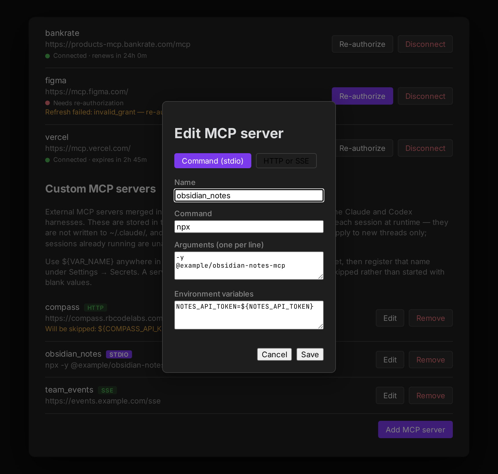
</p>

Agents can also call `mcp_register_server` to propose a server. A host dialog shows the unresolved configuration and asks you to **Register server** or **Cancel**, including when normal tool permissions are bypassed. Approval saves globally for newly initialized Claude and Codex sessions; it does not launch a command, contact an endpoint, or change the calling session's tools. Scheduled threads return an unavailable result instead of waiting for a dialog.

The tool accepts a flat `name`, `type` (`stdio`, `http`, `sse`, or `oauth`), plus `command`/`args`/`env` for stdio or `url`/`headers` for remote servers. An identical retry is unchanged; a different configuration under an existing name is rejected. Built-in and prototype-related names are reserved. Remote URLs must use HTTP(S) and cannot contain embedded credentials.

#### OAuth-gated servers

A remote MCP server that requires OAuth 2.1 + PKCE (Vercel's, for example) registers with `type: "oauth"` instead of `"http"`. The plugin brokers the whole flow itself — discovery, Dynamic Client Registration, consent, token custody, refresh, and revocation — so neither Claude nor Codex needs any OAuth-specific code; both harnesses see the server as a plain authenticated HTTP endpoint behind a local per-server proxy.

Connect one either way:

- **Settings → MCP → Add MCP server → OAuth.** For well-known servers (Atlassian, v0, Linear, Notion, Vercel, Sentry, Asana) skip the form: the **Quick connect** section above the OAuth servers list has a row per server with a **Connect** button (and **Disconnect** with live status once connected). Asana has no Dynamic Client Registration, so its Connect button first asks for your own Client ID and Client secret from an app you register with the provider. Or use the form: fill in a name and the server's URL; scopes, a tool allow/deny filter, and `clientId`/`authorizationServerUrl`/`redirectUri` overrides are optional. Set `redirectUri` for providers that register one exact callback URI instead of accepting any loopback port — Slack's MCP server requires `http://localhost:3118/callback` (note `localhost`, not `127.0.0.1`: exact string matching makes those different URIs).
- **Ask an agent** to call `mcp_register_server` with `type: "oauth"`.

The plugin is a public client by default — PKCE, no secret at all. For the few providers that issue a `client_secret` and then require it at the token endpoint, the OAuth form's Advanced section has a masked **Client secret** field, and the tool takes `clientSecret` as a `${NAME}` placeholder naming a secret already saved with `request_secret` (a literal is rejected, because tool arguments are logged verbatim). Either way the secret lives only in the OS keychain; `data.json` records only that one exists.

Some authorization servers refuse to register a loopback callback at all, which makes the browser flow impossible rather than merely awkward. Set **Grant type → Client credentials** (or `grantType: "client_credentials"`) for those, and for any MCP server that stands for a service rather than a signed-in user: the plugin authenticates as itself with a client ID and secret, so no browser opens and no callback is needed. That grant requires both a client ID and a secret, rejects `redirectUri`, and takes an optional `audience` — nonsecret, passed literally — for providers like Auth0 that mint a token per API. It keeps no refresh token (RFC 6749 §4.4.3 says it shouldn't get one) and re-mints from the keychain secret instead, so its status row reads "Connected · renews in …" and a failure reads "Needs new credentials".

<p align="center">
  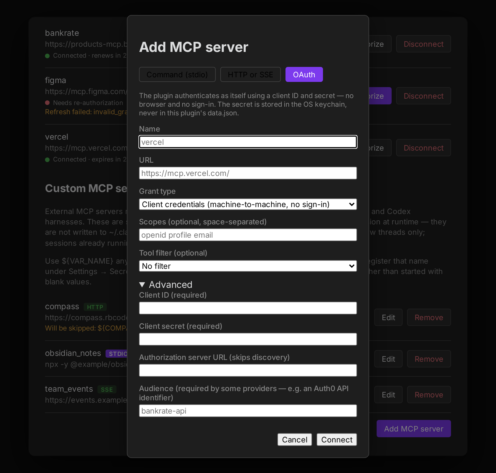
</p>

Both run the same flow and the same validation. Unlike the other transports the default grant is asynchronous and interactive: discovery runs, the provider's consent screen opens in the host's Web Viewer, and the flow waits up to 5 minutes for you to finish signing in before exchanging the code for tokens and starting the proxy. Denying consent or letting the window lapse leaves no partial state behind. Client credentials skips all of that and just calls the token endpoint. Either way a scheduled thread gets an `unavailable` result rather than a stalled dialog — a registration that grants the plugin a new outbound connection wants a human present, and the grant without a consent screen wants one more, not less.

Settings → **MCP → OAuth MCP servers** lists every connected server with a live status (connected + expiry countdown, expiring soon, needs re-authorization, or — for a machine-to-machine server — connected + renewal countdown) a **Re-authorize** button (highlighted when the status is anything short of healthy) that reruns the consent flow from the stored configuration without removing the server, and a **Disconnect** button, which revokes the tokens upstream, clears the keychain, and stops the proxy. Changing a connected server means disconnecting and reconnecting rather than editing it in place, so the OAuth option appears only when adding. See [`mcp-registration.md`](mcp-registration.md#oauth-gated-servers-type-oauth) for the full field reference. Access and refresh tokens live only in the OS keychain, never in `data.json`.

<p align="center">
  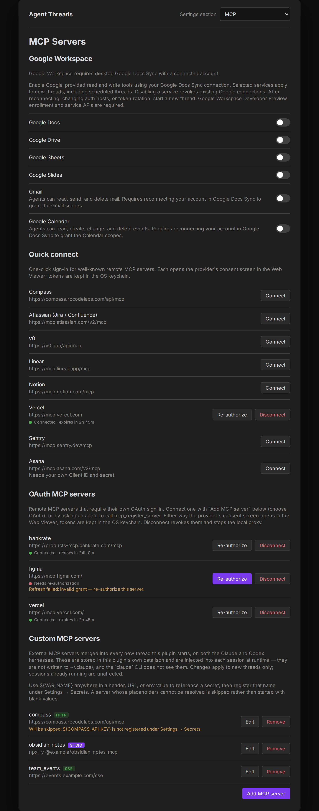
</p>

Use `${NAME}` for every credential and `request_secret` to save its value securely. Common credential fields are validated, but arbitrary argument strings cannot be reliably classified: all literal values must be nonsecret. Registration returns status and required variable names, never resolved credentials. Missing variables are checked when a future session initializes. See [agent registration details](mcp-registration.md).

### Remote access (mobile)

Agent Threads can mirror your desktop sessions to Obsidian Mobile in real time. Your phone becomes a thin client: you can read the conversation as it streams, send messages, approve permission requests, answer AskUserQuestion prompts, and switch between threads — all over a secure WebSocket relay. The desktop does all the actual Claude work; mobile just shows the state.

**Prerequisites:**

- Obsidian desktop with Agent Threads installed and running
- Obsidian Mobile with Agent Threads installed via [BRAT](https://github.com/TfTHacker/obsidian42-brat)
- Both devices on any internet connection (no LAN required)

**Setup:**

1. On desktop: open Settings > Agent Threads > Remote Access and toggle **Enable remote access** on
2. Click **Show pairing QR code** — a QR code appears with a 5-minute expiry window
3. On mobile: open the Agent Threads ribbon icon, tap **Connect to Desktop**, then scan the QR code (or tap the `claude-threads://pair` link if you're on the same device)
4. The mobile view refreshes to show all your desktop threads

**Manual pairing (URI scheme):**

If you can't scan a QR code, send yourself the pairing link directly:

```
claude-threads://pair?roomId=<ROOM_ID>&relay=<RELAY_URL>
```

Opening this URL on any device with Obsidian Mobile + Agent Threads installed will pair it to your desktop.

**What you can do on mobile:**

- Read streaming conversation output and tool calls in real time
- Send messages, approve or deny permission requests (including **Always Allow**)
- Answer **AskUserQuestion** prompts — single-select and multi-select options plus a free-text "Other" field, same as desktop
- Switch between threads and search the thread list by title or summary
- See each thread's **status rail** — spinner cards for active tool calls, error cards for failed threads
- Copy any assistant message to clipboard with the ⎘ button
- View the thread's **context pill** (Project + working directory), **model**, and **message timestamps**
- See **queue rows** for pending messages (tap to pull back into the composer, × to cancel)
- View **tool pill icons** matching the desktop view

**Limitations:**

- Desktop must be running and connected — mobile cannot start new Claude sessions without desktop
- Mobile is a read-mostly thin client; it cannot access your vault files or run tools directly
- One desktop per room ID; rotate the room ID in settings to revoke all mobile access

<p align="center">
  
</p>

### Compressed conversation view

Long agentic threads — especially ones with many tool calls spread across dozens of turns — can be hard to scan. Toggle **Compress view** from the `⋯` menu (top-right of the conversation panel) to collapse the history into a scannable list of one-line summaries.

**How it works:**

- Each entry represents one *exchange*: a user message followed by all the consecutive assistant turns that came back before the next user message (i.e., a full agentic run)
- The summary for each entry is generated by running the combined content of all assistant turns through a lightweight background process — so you get one meaningful summary ("Investigated codebase, added 4 MCP tools, wrote tests") rather than N fragments
- Summaries are generated lazily in a serial queue (one at a time) so toggling compress view on a 50-message thread won't spawn 50 simultaneous Claude processes
- Click the **⌄** arrow on any entry to expand it and read the full response with all tool calls intact
- Toggle the menu item again (now labelled **Expand view**) to return to the normal conversation view

Summaries are cached in memory for the session. They regenerate on the next reload — which keeps storage simple while keeping the background work cheap (the in-process model is fast and inexpensive).

### Thread summaries

A summary bar above the messages shows what the thread is about, and the summarizer also names the tab for you.

With **Enable summarization** on (the default), a thread is summarized once per **completed turn** — not once per assistant message, and not once per tool call. It runs for background and scheduled threads too, not just the one you're looking at.

How often it runs depends on **Auto-summarize after response**:

| Auto-summarize | Before you rename the thread | After you rename it |
|---|---|---|
| Off (default) | Summarized every completed turn | Stops entirely — no further summarizer calls |
| On | Summarized every completed turn | Still summarized every completed turn; your title is kept |

Manual summarize (the brain icon, or the "Summarize active thread" command) always applies the new title regardless of what the tab is currently named. If there's nothing new worth summarizing, it leaves the existing summary untouched and says so.

A few things it deliberately won't do: it skips the model entirely when a turn produced no text (a run of pure tool calls), it won't overwrite a good summary with an empty or unparseable response, and it rejects placeholder titles like "Transcript empty". Turns that end in an error or are interrupted don't retitle the thread — the next completed turn does.

Each summarizer call runs in an isolated one-shot subprocess with no tools, no MCP servers, and no settings files loaded, so auto-naming stays cheap no matter how large your `~/.claude/settings.json` is.

When you switch back to a thread you haven't viewed in over a minute, a **context recap banner** floats at the top of the conversation showing the thread summary and how long ago you were last active. It auto-dismisses after 10 seconds or when you send a message.

<p align="center">
  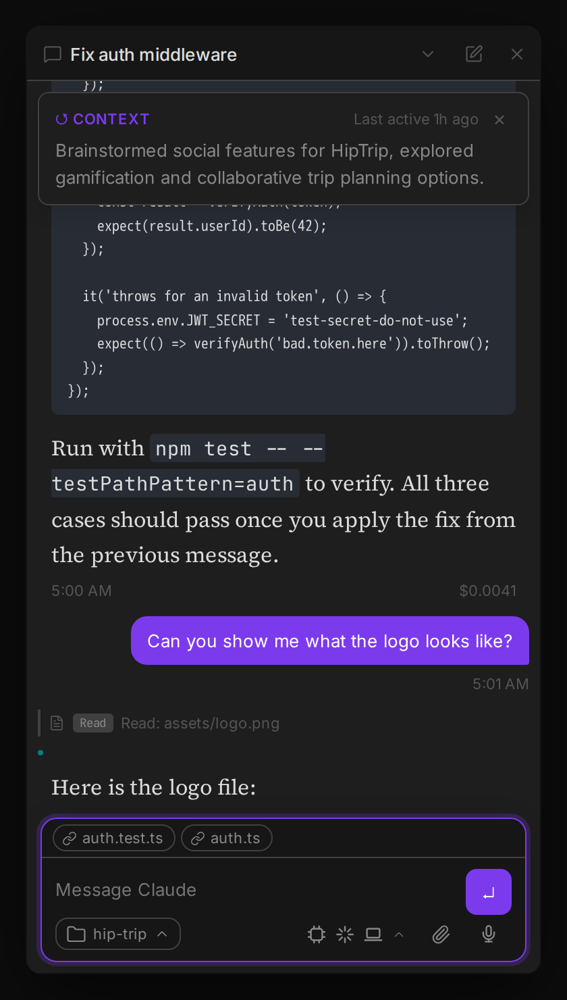
</p>

### Projects

Projects group related threads, choose their initial working directory, inject shared context, and may own a Project Orchestrator. Project coordination tools are operationally scoped; vault tools, MCP server/skill registration, and filesystem access remain broader capabilities rather than a security boundary. Secrets are the one exception: a keychain secret can optionally be restricted to specific Projects (see [Settings](settings.md)) — unscoped secrets remain global, and a Project-less thread never receives a Project-scoped secret.

**Creating a project:** Open Settings → Agent Threads, choose **Projects** (listed under **Agent Threads** in Geode's Settings sidebar, or in the **Settings section** selector in Obsidian), and click **New project**. Enter a project name and vault folder path, then **Create project**. Optionally set a filesystem cwd override for a repo outside the vault. Settings shows the resolved effective cwd; clear the override to derive it from the vault folder again. You can also add a project context prompt — a few sentences describing the project's goals, conventions, and key files that Claude should always keep in mind.

**Project overview note:** Each Project can have an overview note that is injected into the system prompt of every thread in the Project, after the context prompt and before any active goal. By default it is `_overview.md` in the Project's vault folder; set **Overview note** in the Project form (or `overviewPath` through the Project MCP tools; clear it to restore the default) to point at a different vault-relative note. Use it for the orientation you want every thread grounded in: what the Project is, where things live, conventions, and recent work. A missing or empty note injects nothing, and there is no size cap, so keep it concise. The note is read when a session starts or restarts.

**Opening a thread in a project:** The new-conversation composer (**New thread**) has a **Project** chip that opens a searchable picker (filter, most-recent or alphabetical sort, keyboard navigation). Choose a Project before sending, or deliberately leave **No Project** to use the global default cwd. Model, goal, loop, attachment, image, and harness kickoff options preserve that selection. The chat view's New Thread flow and agent-created child threads keep their existing Project inheritance behavior.

**Moving an existing thread:** Open the **⋯** menu in the chat view and choose **Move to Project…**, then pick a Project or **(No project)**. This works regardless of coordination scope, so a thread started outside any Project — including one that just created the Project — is never stranded. Moving into a Project switches the thread to that Project's working directory, which starts a fresh session on the next message; detaching leaves the cwd alone. The item is hidden for the Portfolio Orchestrator and for any thread that owns a Project, since neither can be reassigned.

**Managing projects:** Choose **Projects** in Agent Threads settings, search or select a project, and edit its details. **Save changes** applies the draft; **Cancel** discards it. Create or open the Project Orchestrator from the detail pane (or, when the Threads Orchestrator plugin is installed, it manages creation and shows a read-only row there). Core never creates a Project Orchestrator on its own: only that button, the `orchestrators.ensure` / `dispatch` API calls, or the plugin do. Archiving a Project Orchestrator disables it (including after a synced-settings reload) until it is deliberately created or enabled again. Changing a Project cwd affects new dispatches and Project-derived new-thread scheduled jobs that do not store an explicit cwd; it does not silently move existing sessions. Deletion requires confirmation, detaches its threads, clears pending proposals, and pins affected schedules to the Project's former effective cwd.

**Giving an orchestrator direction:** A Project's context prompt can act as its goal contract. The headings are optional, but this shape gives the orchestrator the clearest operating boundaries:

```markdown
## Desired outcome
...

## Current priority
...

## Done when
...

## Constraints and non-goals
...

## Risk tolerance
...
```

For each new thread, the orchestrator first looks for an explicit `/goal`, the initiating request, and a concrete completion condition. Clear requests are recorded as **user-stated** and proceed without another interview. If the intended outcome or definition of done is ambiguous, the orchestrator records that it is awaiting direction and asks one focused question in the Project Orchestrator conversation before proposing execution, inspection, or verification. A later answer can make the goal **user-confirmed**; an **inferred** goal may guide the explicit work already underway but never expands its scope.

Orchestrators use each thread's exact `updatedAt` value as their review cursor. Wake-ups on completion events and the hourly heartbeat that reconciles missed activity are provided by the Threads Orchestrator plugin, not core; without it, threads work as a manual workspace with no automatic wake-ups. Targeted reviews cover only the named changed threads. Threads with unchanged state are not reread or rewritten, unanswered goal questions are not repeated, and concluded work stays quiet unless new evidence appears. Verification is limited to one additional orchestrator-requested pass for a substantive implementation state unless a new failure, external change, user direction, or concrete risk justifies another.

**Scheduled work:** Cron items resolve their effective cwd at fire time in this order: explicit scheduled-item cwd, current Project cwd, then the global default. The same resolved path is used for a gate command and its spawned thread. Cron create/update rejects unknown Projects, and a deleted Project reference fails the run rather than dispatching in an unrelated fallback directory.

**Schedule Manager:** Settings → Scheduled presents every non-system item once in two compact groups: recurring jobs, and thread loops/wakeups. Rows are collapsed by default and sorted by next occurrence, with paused work last. The summary shows status, cadence, next run or check, Project, and execution environment; expand a row to inspect its prompt, active hours, effective working directory, gate, run history, and controls. New-thread jobs show the global harness and model they will inherit at fire time (a blank model means the CLI default). Loops and wakeups show the target thread's harness/model; a missing target is called out along with its new-thread fallback.

### Status line (context footer)

A row of pills below the input area shows live context for each thread — git branch, an open PR, a running dev server URL, AWS session status, or anything else you want. It's powered by a shell command (Settings → **Context footer command**) that the plugin runs **per thread, in the background**, against that thread's working directory. Desktop only.

> **Note:** `pr` and `branch` pills are hidden while the [git diff bar](#git-diff-bar-create-pr) is on screen, since that bar already shows the branch and a PR button labelled with the PR number. Your script doesn't need to know about this — emit whatever tags you like and the plugin drops the redundant ones.
>
> **Keep emitting the `pr` tag even though it's usually hidden.** It isn't just a pill: it's the only source of a thread's PR association. The plugin derives `prUrl` from it, which drives the diff bar's **PR #N** button, the Agent Board PR chip, and the archive-on-merge release workflow. Drop the tag to "save" a `gh` call and those all go dark. A `pr` tag whose repo provably differs from the thread's current repo is ignored, so a thread moved between projects won't keep advertising its old PR.

<p align="center">
  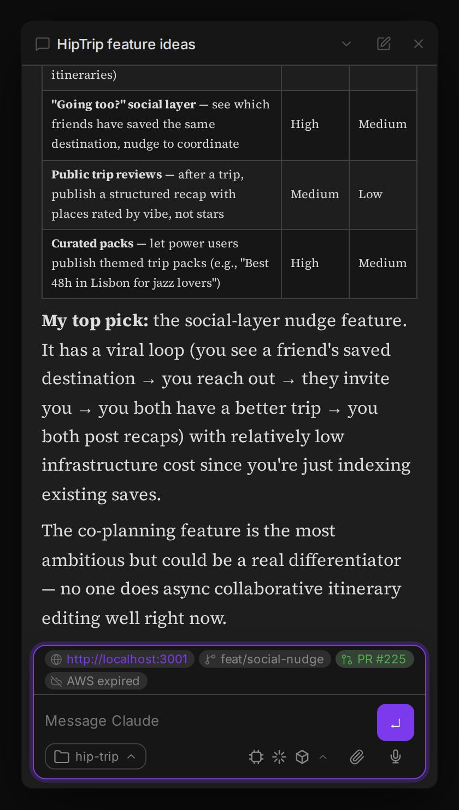
</p>

**Output format.** The command can return either:

- **A JSON array of tags** (recommended) — each pill is a `StatusTag`:

  ```json
  [
    { "label": "http://localhost:3001", "url": "http://localhost:3001", "kind": "dev" },
    { "label": "feat/social-nudge", "kind": "branch" },
    { "label": "PR #225", "url": "https://github.com/acme/app/pull/225", "kind": "pr" },
    { "label": "AWS expired", "tone": "warn", "kind": "aws" }
  ]
  ```

  | Field | Meaning |
  |---|---|
  | `label` | **Required.** Pill text. |
  | `url` | Makes the pill a clickable link (opens in your browser). |
  | `icon` | [Lucide](https://lucide.dev) icon name. Defaults from `kind` if omitted. |
  | `tone` | `normal` (default), `warn`, or `error` — colors the pill. |
  | `kind` | `pr`, `branch`, `dev`, `aws`, or any custom string. A `kind:"pr"` tag (or any `url` ending in `/pull/N`) becomes the thread's PR — shown as the PR pill and surfaced to the Agent Board, MCP tools, and release automation. |

- **Plaintext** (the Claude Code statusline convention) — segments split on 2+ spaces, with heuristic icons (URL→globe, `PR #N`→pull-request, `AWS …`→cloud, else→branch). Existing scripts keep working unchanged.

**Input.** The command receives JSON on stdin: `{ "cwd": "…", "workspace": { "current_dir": "…" }, "provider": "claude" | "bedrock" }`. Use `provider` to gate provider-specific pills — e.g. only emit an AWS pill when `provider == "bedrock"` so a logged-out AWS session doesn't show a spurious warning on a non-Bedrock machine.

**PR detection** is fully script-driven: a `kind:"pr"` tag with a `url` (e.g. from `gh pr view`) populates the thread's `prUrl`, which is **sticky** — it survives after the PR merges so release tooling can still match the thread.

**Opening links:** clicking a pill with a `url` opens it in a fresh tab in the host's in-app **Web Viewer** when available; otherwise it opens in your system browser. **Cmd-click** (Ctrl-click on Windows/Linux) always opens in the system browser, even when the Web Viewer is enabled.

A ready-to-use reference script (branch · PR · dev URL · Bedrock-gated AWS) ships at [`statusline-command.example.sh`](statusline-command.example.sh).

### Git diff bar (Create PR)

Whenever a thread's working directory is a git repo on a feature branch, a bar appears just above the compose box showing the branch name and a live diff stat (`+60 -4`) — the total change between the branch's base (e.g. `main`) and the current working tree, including any uncommitted changes. Unlike the status-line pills above, this needs no configuration: it's computed natively from local `git` commands only (no `gh`, no network), and is desktop only, mirroring the status line's mobile no-op.

A **Create PR** split button sits on the right:

- **Create PR** — sends the configured **Create PR message** directly to the active agent. The default is `/create-pr`.
- **Create draft PR** (dropdown) — sends its independently configured draft message. The default is `/create-pr --draft`, and the action is also available by typing that command.

Configure both messages under **Settings → General → Pull requests**. They may be plain-language prompts or commands backed by skills in your agent system. If a slash command is not defined there, it is still delivered as an ordinary message and the receiving agent decides how to handle it. Leaving either setting blank restores its default when the action runs.
- **Manually create PR** (dropdown) — skips Claude entirely and opens GitHub's compare page (`/compare/<base>...<branch>`) in your browser (Web Viewer or system browser, same convention as status-line pill links), so you can review the diff and open the PR yourself. Only enabled when the repo's `origin` remote points at GitHub.

The bar is hidden when the cwd isn't a git repo, when the branch can't be resolved (e.g. detached HEAD), or when you're already sitting on the base/default branch (nothing to open a PR against).

Once the **current branch** has a PR, the primary button switches to the PR's number — **PR #121** — opening it the same way pill links do, with the full URL as a tooltip, and a **View PR** item is prepended to the dropdown; the other three actions stay available in case you want to open another PR later.

That PR comes from the live `pr` tag emitted by your [context footer command](#status-line-context-footer) (typically a branch-scoped `gh pr view "$branch"`), *not* from the thread's sticky `prUrl`. The distinction matters: `prUrl` is thread-scoped history that is deliberately never cleared — it survives a branch switch and even a `set_working_directory` into a different repository — so that the archive-on-merge release workflow can still match a thread to its PR after the branch is deleted. Reusing a long-lived thread for a second task would otherwise leave the bar advertising a stale, unrelated PR next to the new branch's name. If no context footer command is configured, the button simply stays on **Create PR**.

Because the bar already names the branch and the PR, it is treated as the single surface for that information: while it's visible, the [context footer](#status-line-context-footer) suppresses its own `pr` and `branch` pills so the same branch and PR number aren't printed twice in adjacent rows. This applies both to pills your status-line command emits and to the footer's built-in sticky-`prUrl` pill. The suppression is conditional — as soon as the bar hides (PR merged and the thread is back on the base branch, a non-git cwd, or a detached HEAD), the footer PR pill reappears as the only remaining surface for that PR.

### Safe plugin reload

Use **Agent Threads: Reload plugin (safe)** from the command palette instead of the host's built-in "Reload plugin" button. When no threads are running it reloads immediately. When threads are active it opens a modal showing their names with three choices: **Cancel** (keep working), **Interrupt & Reload** (sends an interrupt signal and waits up to 30 seconds for a clean shutdown), or **Force Reload** (kills sessions immediately). Reloading via any other path (Settings toggle, manifest hot-reload) triggers a graceful 10-second interrupt wait automatically before teardown.

### Diagnostics report

When the host app feels slow — the renderer pinning a core, typing lag, or a machine where an EDR/antivirus agent taxes every subprocess — Agent Threads keeps a small, **always-on, local-only** diagnostics layer running so you can capture what's actually happening. Nothing ever leaves your machine: there are no network calls and no remote reporting.

In the background it tracks a few cheap signals: how often the Agent Board rebuilds vs. how often a render was merely requested (measuring the incremental-render coalescing), how many `git`/status-line subprocesses were spawned, how many settings saves coalesced into actual disk writes, plus a ring of renderer CPU/memory samples (taken only while a plugin view is open) and a summary of any long main-thread tasks. It works identically in real Obsidian and in the Geode desktop app, and is a complete no-op on mobile.

Run **Agent Threads: Generate diagnostics report** from the command palette (or click **Copy diagnostics** in Settings → General → Diagnostics). It:

- copies a **redacted** Markdown report to your clipboard, ready to paste into a GitHub issue, and
- saves that Markdown plus a raw `.json` bundle into an `agent-threads-diagnostics/` folder in your vault root, then shows a Notice with the path.

The report is redacted by construction: it never includes message or file contents, absolute paths are collapsed to `~` or reduced to a basename (so no username or private directory layout leaks), and obvious `SECRET=value` strings are stripped. On mobile the command shows a "desktop only" Notice and does nothing.

You can turn the whole layer off with the **Diagnostics** toggle in Settings → General (it's on by default, which is safe because everything stays local); turning it off stops the sampler and freezes the counters.

